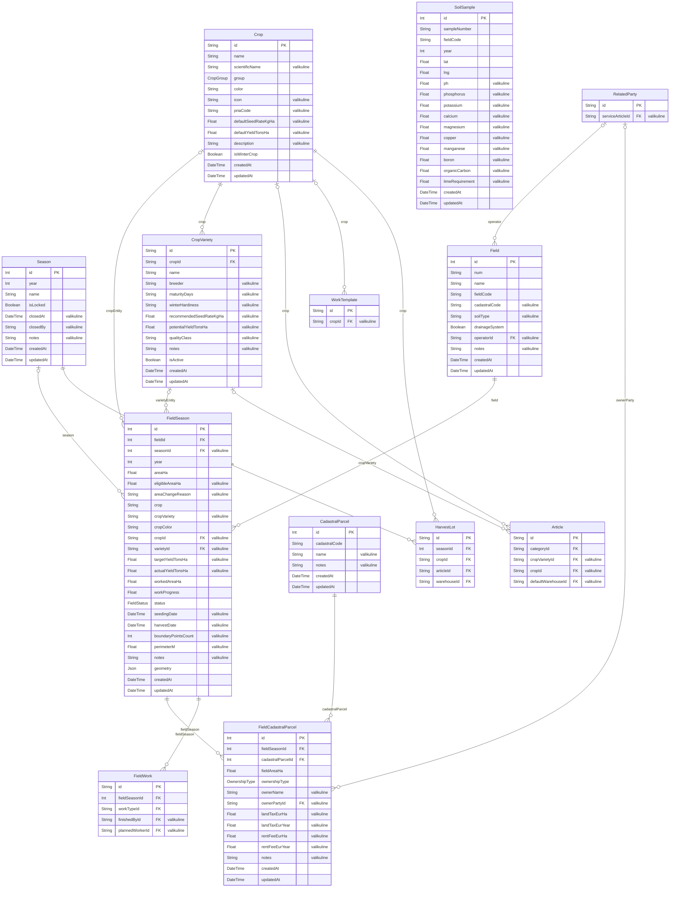
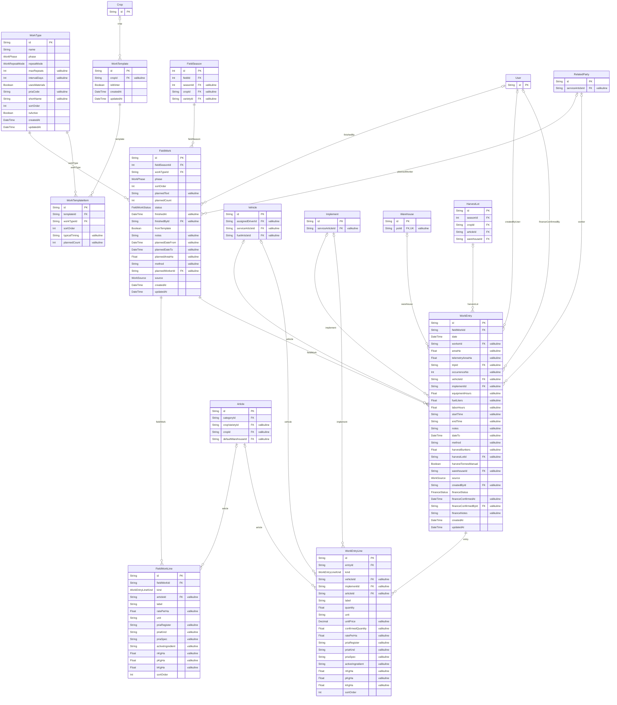
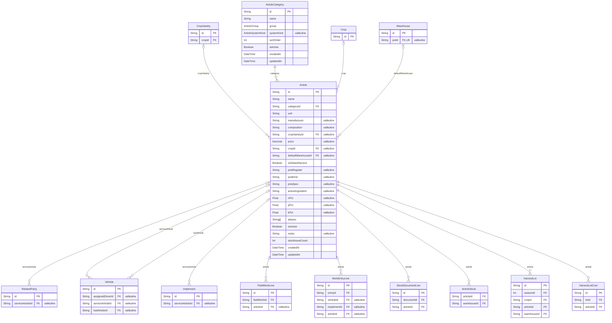
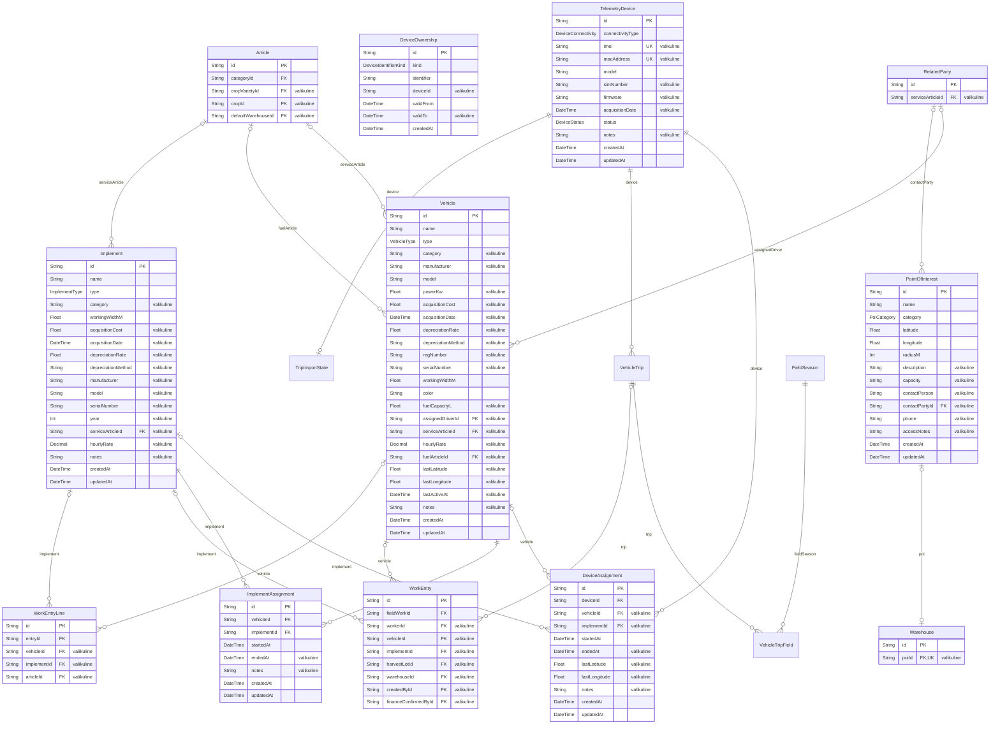
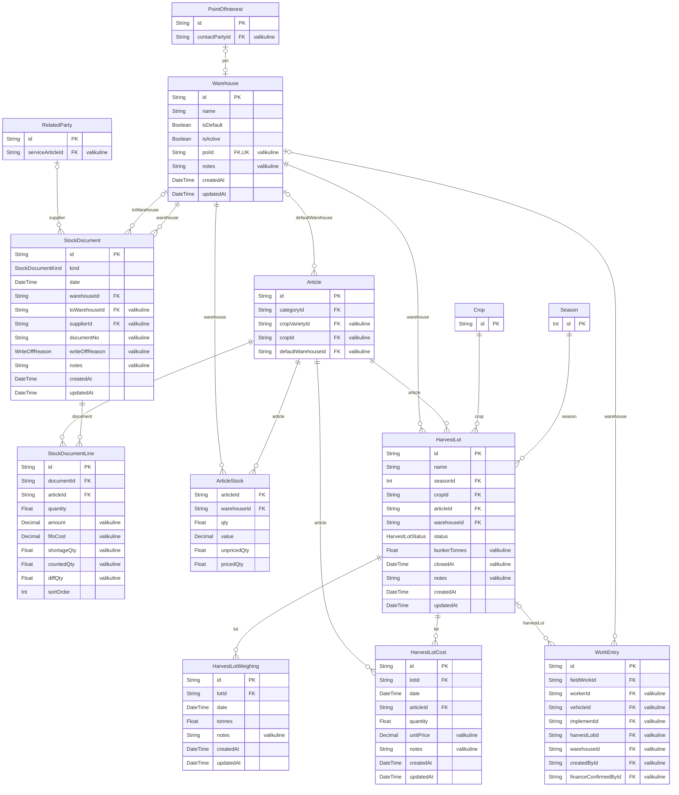
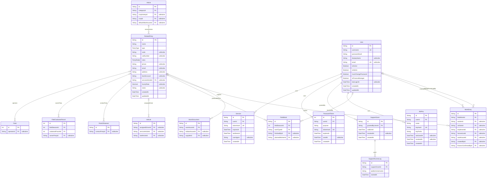

# Andmemudel (ERD)

Genereeritud skriptiga `scripts/generate-erd.mts` failist `prisma/schema.prisma` (2026-11-03). Ära muuda käsitsi — käivita `npx tsx scripts/generate-erd.mts` pärast skeemimuudatust.

Millised vaated ja komponendid neid tabeleid loevad ja muudavad, vaata [vaated-ja-andmed.md](vaated-ja-andmed.md).

**Lugemisjuhend**
- `PK` primaarvõti, `FK` võõrvõti, `UK` unikaalne; kommentaar "valikuline" tähendab, et väli võib olla tühi.
- Seose sümbolid: `||` täpselt üks, `|o` null või üks, `o{` null või mitu. Seose nimi on võõrvõtme välja nimi.
- Iga ettevõttepõhise tabeli veerg `tenant_id` (ettevõte, Postgres RLS) ning auditiveerud `createdBy`/`updatedBy` on skeemidelt välja jäetud.
- Valdkonna skeemis on teise valdkonna tabelid kuvatud ainult võtmetega.

## Sisukord
1. [Põllud, hooajad ja kultuurid](#põllud-hooajad-ja-kultuurid)
2. [Põllutööd ja kanded](#põllutööd-ja-kanded)
3. [Artiklid](#artiklid)
4. [Masinapark, telemeetria ja objektid](#masinapark-telemeetria-ja-objektid)
5. [Laoarvestus](#laoarvestus)
6. [Isikud, kasutajad ja tugi](#isikud-kasutajad-ja-tugi)
7. [Platvorm (teenusepakkuja)](#platvorm-teenusepakkuja)
8. [Kõik seosed (ülevaade)](#kõik-seosed-ülevaade)
9. [Loendid (enum)](#loendid-enum)

## Põllud, hooajad ja kultuurid

Põld on püsiv kirje; iga hooaja andmed (pindala, kultuur, piir, saak) on eraldi hooaja põllu kirjes. Katastriüksused seotakse hooaja põlluga koos omandi ja kuludega.

| Mudel | Tabel | Ettevõttepõhine | Sisu |
|---|---|---|---|
| `Season` | `seasons` | jah | Hooaeg (aasta); lukustatud hooaja andmeid ei muudeta |
| `Field` | `fields` | jah | Põld (püsiv): PRIA põllu nr, massiiv, nimi, operaator |
| `FieldSeason` | `field_seasons` | jah | Põllu hooaja andmed: pindala, kultuur, sort, piir (GeoJSON), saak, staatus |
| `CadastralParcel` | `cadastral_parcels` | jah | Katastriüksus (tunnus, nimi) |
| `FieldCadastralParcel` | `field_cadastral_parcels` | jah | Hooaja põllu ja katastriüksuse seos: põllu osa pindala, omand/rent, maamaks, rent |
| `Crop` | `crops` | jah | Kultuur (ettevõtte register; PRIA kood, talivili, värv) |
| `CropVariety` | `crop_varieties` | jah | Sort kultuuri all |
| `SoilSample` | `soil_samples` | jah | Mullaproov (pH, P, K, Ca, Mg, Corg; asukoht) |

- Mullaproovid seotakse põlluga massiivi numbri järgi (`fieldCode`) ja kaardil asukoha järgi, mitte võõrvõtmega.

## Põllutööd ja kanded

Töö on hooaja põllu planeeritud tegevus (PRIA tegevus), plaaniread on planeeritud materjalid normiga. Kanne on tegelikult tehtud töö osa; kande read on tööaeg, masin, kütus, materjalid, saak ja seire leiud.

| Mudel | Tabel | Ettevõttepõhine | Sisu |
|---|---|---|---|
| `WorkType` | `work_types` | jah | Töötüüp = PRIA tegevus (29), faas, lühinimi |
| `FieldWork` | `field_works` | jah | Töö (plaan) hooaja põllul: kuupäevad, pindala, viis, teostaja, staatus, allikas |
| `FieldWorkLine` | `field_work_lines` | jah | Töö plaanirida: planeeritud materjal (norm/ha, PRIA atribuudid) või saak |
| `WorkEntry` | `work_entries` | jah | Kanne = tehtud töö osa: kuupäev, töötaja, masin, haakeriist, tunnid, kütus, pindala, finantsi olek |
| `WorkEntryLine` | `work_entry_lines` | jah | Kande rida: tööaeg, masin, haakeriist, kütus, materjal, saak, seire leid (kogus, ühik, hind) |
| `WorkTemplate` | `work_templates` | jah | Tööde mall (kasutuseta) |
| `WorkTemplateItem` | `work_template_items` | jah | Tööde malli rida (kasutuseta) |

- Töötüübid = PRIA e-põlluraamatu 29 tegevust (`priaCode`); `shortName` on ettevõtte lühinimi.
- `WorkTemplate` ja `WorkTemplateItem` (tööde mallid) on andmebaasis alles, aga rakendus neid enam ei kasuta.

## Artiklid

Artikkel on kõik, mida põllutöödel kulutatakse või toodetakse: teenused (tööaeg), kulumaterjalid, toodang ja muu kaup. Plaani- ja kanderead, laokanded, saagipartiid ning masinate, haakeriistade ja töötajate teenused viitavad artiklile. Artikkel kuulub kategooriasse, kategooria kuulub gruppi.

| Mudel | Tabel | Ettevõttepõhine | Sisu |
|---|---|---|---|
| `ArticleCategory` | `article_categories` | jah | Artikli kategooria (grupp, süsteemne kategooria) |
| `Article` | `articles` | jah | Artikkel: teenus (tööaeg) või kaup (kulumaterjal, toodang, muu kaup) |

- Kasutajaliidese nimed: ekraanil on ingliskeelse nime tõlge — `ArticleGroup` = **grupp** (filtrinupud Teenus, Kulumaterjal, Toodang, Muu kaup), `article_categories` = **kategooria** (nupp „Kategooriad“), `systemKind` = süsteemne kategooria, `priaRegister` = **PRIA register**, `priaKind` = **PRIA täpsustus** (artiklite tabelis veerg „Täpsustus“ koos terade kultuuriga), `priaSpec` = **PRIA spetsifikatsioon** (seemne kategooria C1, C2 jne), `name` = **nimetus**.
- Reeglid (mis väli millisel kategoorial on, mis reale artikli saab panna, teenuse hind, kütuseartikkel): `src/services/articleRules.ts`. Kande artiklite leidmine: `src/server/entryArticles.ts`.

### Grupid (`ArticleGroup`)

| Grupp | Tähendus | Laoarvestus |
|---|---|---|
| `SERVICE` | Teenus: töötaja, masina, haakeriista või kuivatamise tööaeg. Ühik tavaliselt h, hind artiklil (`price`). | Ei |
| `CONSUMABLE` | Kulumaterjal: seeme, väetis, taimekaitsevahend, kütus, kuivatusõli, kasutaja kategooriad. | Jah (FIFO) |
| `PRODUCE` | Toodang: terad (saagipartii kaalumine võtab lattu hindamata). | Jah |
| `OTHER_GOODS` | Muu kaup (nt edasimüük, varuosad); ainult kasutaja loodud kategooriates. | Jah |

Kaup = iga grupp peale `SERVICE` (`isGoods`). Kategooriat ei saa teenuse ja kauba vahel ümber tõsta.

### Kategooriad (`article_categories`)

Süsteemsed kategooriad luuakse igale ettevõttele automaatselt ja neid ei saa kustutada ega teise gruppi viia; loogika käitub `systemKind` järgi. Kasutaja loodud kategoorial on `systemKind` tühi ja see käitub nagu oma grupi tavaline kategooria. Kategooria nimi on ettevõttes unikaalne; kategooria saab kustutada ainult siis, kui selles pole artikleid.

| `systemKind` | Kategooria | Grupp | Lisaväljad artiklil | Kasutus |
|---|---|---|---|---|
| `LABOR_TIME` | Töötaja tööaeg | `SERVICE` | `price` | kande tööaja rida |
| `MACHINE_TIME` | Masina tööaeg | `SERVICE` | `price` | kande masina rida |
| `IMPLEMENT_TIME` | Haakeriista tööaeg | `SERVICE` | `price` | kande haakeriista rida |
| `DRYING_TIME` | Kuivatamise tööaeg | `SERVICE` | `price` | saagipartii kuivatuskulu |
| `SEED` | Seeme | `CONSUMABLE` | PRIA (`priaRegister`, `priaKind`, `priaSpec`), sort (`cropVarietyId`) | plaani-/kande materjalirida |
| `FERTILIZER` | Väetis | `CONSUMABLE` | PRIA, N/P/K % | plaani-/kande materjalirida |
| `PLANT_PROTECTION` | Taimekaitsevahend | `CONSUMABLE` | PRIA, toimeaine (`activeIngredient`) | plaani-/kande materjalirida |
| `FUEL` | Kütus | `CONSUMABLE` | vaikimisi ladu (mahuti) | kande kütuserida (oma rida, mitte materjal) |
| `DRYING_OIL` | Kuivatusõli | `CONSUMABLE` | vaikimisi ladu | saagipartii kuivatuskulu |
| `GRAIN` | Terad | `PRODUCE` | kultuur (`cropId`) | saagipartii toodanguartikkel |

Kaubale saab määrata vaikimisi lao (`defaultWarehouseId`, valikuline; teenusel puudub). PRIA import paneb tundmatud kulumaterjalid kategooriasse „Muu kulumaterjal“ (luuakse vajadusel).

### Teenused ja hind kandel

- Igal tööaja kategoorial on üks vaikimisi teenus (`isDefaultService`); puudumisel luuakse see kategooria nimega (ühik h, hind tühi).
- Masinal, haakeriistal ja töötajal (`vehicles`, `implements`, `related_parties`) võib olla oma teenus (`serviceArticleId`) ja oma tunnihind (`hourlyRate`, näeb ainult admin/finants).
- Kande tööaja rea hind: ressursi tunnihind → ressursi teenuse hind → vaikimisi teenuse hind (`pickServicePrice`).
- Kütuserea artikkel: masina vaikimisi kütus (`fuelArticleId`), muidu ettevõtte ainus aktiivne kütus; artiklita kütuserida ei lase kannet kinnitada. Kütus kantakse maha kütuseartikli vaikimisi laost, kulumaterjal kande laost.
- Kande muutmisel jääb teenuse- ja kütusereale vana artikkel ja hind (ajalugu ei muutu tagantjärele).

### Kaubad ja ladu

- Laoseis ja väärtus arvutatakse FIFO järgi artikli ja lao kaupa (`article_stock`, vt [Laoarvestus](#laoarvestus)); kande materjali- ja kütuserea `unitPrice` = FIFO hind.
- `unit` on laoühik; laokande read on alati selles ühikus. Ühiku muutmisel teisendatakse read teguriga ja ühikuhind jagatakse sellega (`src/server/articleUnitChange.ts`); saagipartiidega artikli ühikut saab muuta ainult kaaluühikuks.
- `stockIssueCount` — kanderead, mille ühikut ei saa laoühikusse teisendada (laoarvestusest väljas).

### Asendamine ja kustutamine

- Asendamine (ühendamine) on lubatud ainult sama kategooria artikliga: kõik viited (plaani-, kande- ja laokande read, kuivatuskulud, ressursside teenused) viiakse sihtartiklile, vana nimi lisatakse sihtartikli `aliases` hulka (PRIA import tunneb selle ära) ja vana artikkel kustutatakse.
- Kasutuses olevat artiklit (plaani-, kande- või laokande read, saagipartii, kuivatuskulu) ei kustutata — see märgitakse mitteaktiivseks. Vaikimisi teenust ei saa kustutada, teise kategooriasse viia ega mitteaktiivseks muuta. Kuivatuskuludega artikli kategooriat ei saa muuta.
- Unikaalsus: nimetus on unikaalne kategooria piires (`tenantId + categoryId + name`).

## Masinapark, telemeetria ja objektid

Masinad, haakeriistad ja telemeetriaseadmed. Seadme omand (ettevõttele kuulumise periood) ja paigaldus masinale/haakeriistale on ajaliste kirjetena; telemeetria mõõtmised ise on eraldi telemeetria andmebaasis.

| Mudel | Tabel | Ettevõttepõhine | Sisu |
|---|---|---|---|
| `Vehicle` | `vehicles` | jah | Masin (traktor, kombain jm): andmed, amortisatsioon, viimane asukoht, juht |
| `Implement` | `implements` | jah | Haakeriist (laius, tüüp) |
| `TelemetryDevice` | `telemetry_devices` | jah | Telemeetriaseade (IMEI vms) |
| `DeviceOwnership` | `device_ownerships` | jah | Seadme kuulumine ettevõttele ajavahemikus |
| `DeviceAssignment` | `device_assignments` | jah | Seadme paigaldus masinale/haakeriistale ajavahemikus |
| `ImplementAssignment` | `implement_assignments` | jah | Haakeriista ühendus masinaga ajavahemikus |
| `VehicleTrip` | `vehicle_trips` | jah | Seadme sõit (süüde sisse → välja), tuletatud telemeetriast; põldude ha summa (`areaHa`); muudetav ainult märkus |
| `VehicleTripField` | `vehicle_trip_fields` | jah | Sõidu osa ühel põllul (hooajal): põllul oldud aeg, ha haakeriista laiusega põllu piires, kütus põllul ja koos teekütuse osaga; haakeriist teabena (mitte FK) |
| `TripImportState` | `trip_import_state` | jah | Seadme sõitude impordi olek (lõplik kuni, viimane viga, kohtade ja seoste sõrmejälg) |
| `PointOfInterest` | `points_of_interest` | jah | Objekt (kuivati, ladu, töökoda jm): asukoht, raadius, kontakt |

- Telemeetria (GPS, süüde, kiirus jm) on eraldi TimescaleDB andmebaasis (`measurements`), seotud seadme IMEI kaudu.

## Laoarvestus

Kulumaterjalide laod, laokanded ja laoseisu koond. Põllutöö kande materjalid kantakse maha kande lao (`WorkEntry.warehouseId`) järgi.

| Mudel | Tabel | Ettevõttepõhine | Sisu |
|---|---|---|---|
| `Warehouse` | `warehouses` | jah | Ladu (üks põhiladu); valikuline seos huvipunktiga |
| `StockDocument` | `stock_documents` | jah | Laokanne: arvele võtmine, mahakandmine või ülekanne |
| `StockDocumentLine` | `stock_document_lines` | jah | Laokande rida: materjal, kogus, hind, FIFO kulu, hindamata kogus |
| `ArticleStock` | `article_stock` | jah | Laoseisu koond materjali ja lao kaupa (kogus, väärtus) |
| `HarvestLot` | `harvest_lots` | jah | Saagipartii: hooaja ja kultuuri koristuse kaalumine ja kuivatus |
| `HarvestLotWeighing` | `harvest_lot_weighings` | jah | Partii kaalumine (tonnid, terade lao sissetulek) |
| `HarvestLotCost` | `harvest_lot_costs` | jah | Partii kuivatuskulu (teenus või kaup) |

- `warehouses` — laod; täpselt üks põhiladu (`isDefault`); valikuline seos huvipunktiga (`poiId`).
- `stock_documents` / `stock_document_lines` — laokanded: arvele võtmine (summa km-ta), mahakandmine (põhjus), ülekanne (lähte- ja sihtladu). `fifoCost` ja `shortageQty` arvutab süsteem.
- `article_stock` — laoseisu koond materjali ja lao kaupa (kogus, väärtus, hindamata kogus); kirjutab ainult ümberarvutus.
- `work_entries.warehouseId` — ladu, kust kande materjalid võetakse (tühi = põhiladu).
- `harvest_lots` — saagipartii (hooaeg + kultuur + ladu): koristuskanded viitavad partiile (`work_entries.harvestLotId`); `harvest_lot_weighings` — kaalumised (terade lao sissetulek, hindamata); `harvest_lot_costs` — kuivatuskulud (teenus või kaup); suletud partii jaotab punkri kaalu kanderidadele (`harvestTonnesManual` = käsitsi tonnid).
- FIFO: liikumised arvutatakse iga muudatuse järel materjali kaupa uuesti (`src/server/stock.ts`); põllutöö kande materjalirea `unitPrice` = FIFO hind.

## Isikud, kasutajad ja tugi

Seotud isikud (töötajad, omanikud, operaatorid, partnerid) ja rakenduse kasutajad. Tugiligipääs lubab teenusepakkujal ettevõtte andmeid ajutiselt vaadata.

| Mudel | Tabel | Ettevõttepõhine | Sisu |
|---|---|---|---|
| `RelatedParty` | `related_parties` | jah | Seotud isik/ettevõte: töötaja, omanik, operaator, partner |
| `User` | `users` | jah | Rakenduse kasutaja (ettevõtte), rollid |
| `Session` | `sessions` | – | Kasutaja sessioon |
| `PasswordToken` | `password_tokens` | – | Parooli seadmise / kutse token |
| `SupportGrant` | `support_grants` | jah | Ettevõtte antud tugiligipääs teenusepakkujale |
| `SupportAccessLog` | `support_access_log` | jah | Tugiligipääsu logi |
| `ApiKey` | `api_keys` | – | AI-ühenduse (MCP) võti: räsi, algus, viimane kasutus, tühistamine |

## Platvorm (teenusepakkuja)

Ettevõtted, litsentsid, platvormi kasutajad, algkataloog uue ettevõtte jaoks, abiartiklid ja landing-lehe andmed. Need tabelid ei ole ettevõttepõhised.

| Mudel | Tabel | Ettevõttepõhine | Sisu |
|---|---|---|---|
| `Tenant` | `tenants` | – | Ettevõte (klient) |
| `TenantLicense` | `tenant_licenses` | jah | Ettevõtte litsents ja moodulid |
| `PlatformUser` | `platform_users` | – | Teenusepakkuja (admin.teris.ee) kasutaja |
| `PlatformSession` | `platform_sessions` | – | Platvormi kasutaja sessioon |
| `PlatformAuditLog` | `platform_audit_log` | – | Platvormi tegevuste logi |
| `SupportSession` | `support_sessions` | – | Tugiligipääsu sessioon |
| `HelpArticle` | `help_articles` | – | Abiartikkel (kasutusjuhend) |
| `CatalogCrop` | `catalog_crops` | – | Algkataloogi kultuur (kopeeritakse uuele ettevõttele) |
| `CatalogCropVariety` | `catalog_crop_varieties` | – | Algkataloogi sort |
| `CatalogWorkType` | `catalog_work_types` | – | Algkataloogi töötüüp (PRIA tegevus) |
| `CatalogWorkTemplate` | `catalog_work_templates` | – | Algkataloogi mall (kasutuseta) |
| `CatalogWorkTemplateItem` | `catalog_work_template_items` | – | Algkataloogi malli rida (kasutuseta) |
| `LandingEvent` | `landing_events` | – | Landing-lehe külastuse sündmus |
| `InterestRequest` | `interest_requests` | – | Landing-lehe huvipäring |
| `PlatformSetting` | `platform_settings` | – | Platvormi seadistus (võti/väärtus, nt AI-ühenduse juhis) |

```mermaid
erDiagram
  Tenant {
    String id PK
    String name
    String registryCode "valikuline"
    TenantStatus status
    String primaryPartyId "valikuline"
    DateTime createdAt
    DateTime updatedAt
  }
  TenantLicense {
    String id PK
    DateTime validUntil
    LicenseModule[] modules
    DateTime updatedAt
  }
  PlatformUser {
    String id PK
    String username UK
    String passwordHash
    String totpSecretEnc
    Int totpLastStep
    Boolean isActive
    DateTime lastLoginAt "valikuline"
    DateTime createdAt
    DateTime updatedAt
  }
  PlatformSession {
    String id PK
    String platformUserId FK
    String tokenHash UK
    DateTime expiresAt
    String userAgent "valikuline"
    DateTime createdAt
  }
  PlatformAuditLog {
    String id PK
    String platformUserId "valikuline"
    String action
    String targetTenantId "valikuline"
    Json details "valikuline"
    DateTime createdAt
  }
  SupportSession {
    String id PK
    String targetTenantId
    String supportGrantId
    String platformUserId
    String handoffTokenHash UK "valikuline"
    DateTime handoffExpiresAt
    String sessionTokenHash UK "valikuline"
    DateTime expiresAt "valikuline"
    DateTime createdAt
  }
  HelpArticle {
    String key PK
    String html
    DateTime updatedAt
    DateTime createdAt
  }
  CatalogCrop {
    String id PK
    String name UK
    String scientificName "valikuline"
    CropGroup group
    String color
    String icon "valikuline"
    String priaCode "valikuline"
    Float defaultSeedRateKgHa "valikuline"
    Float defaultYieldTonsHa "valikuline"
    String description "valikuline"
    Boolean isWinterCrop
    DateTime createdAt
    DateTime updatedAt
  }
  CatalogCropVariety {
    String id PK
    String catalogCropId FK
    String name
    String breeder "valikuline"
    String maturityDays "valikuline"
    String winterHardiness "valikuline"
    Float recommendedSeedRateKgHa "valikuline"
    Float potentialYieldTonsHa "valikuline"
    String qualityClass "valikuline"
    String notes "valikuline"
    Boolean isActive
  }
  CatalogWorkType {
    String id PK
    String name UK
    WorkPhase phase
    WorkRepeatMode repeatMode
    Int maxRepeats "valikuline"
    Int intervalDays "valikuline"
    Boolean usesMaterials
    String priaCode UK "valikuline"
    Int sortOrder
    Boolean isActive
  }
  CatalogWorkTemplate {
    String id PK
    String catalogCropId FK "valikuline"
    Boolean isWinter
  }
  CatalogWorkTemplateItem {
    String id PK
    String templateId FK
    String catalogWorkTypeId FK
    Int sortOrder
    String typicalTiming "valikuline"
    Int plannedCount "valikuline"
  }
  LandingEvent {
    BigInt id PK
    DateTime ts
    String source
    String event
    String target "valikuline"
    String path
    String visitorClass
    String botName "valikuline"
    String referrerHost "valikuline"
    String utmSource "valikuline"
    String utmMedium "valikuline"
    String utmCampaign "valikuline"
    String device
    String visitorHash
  }
  InterestRequest {
    String id PK
    DateTime createdAt
    DateTime updatedAt
    String name
    String email
    String company "valikuline"
    String phone "valikuline"
    Float areaHa "valikuline"
    String message "valikuline"
    InterestStatus status
    String notes "valikuline"
    DateTime closedAt "valikuline"
    String utmSource "valikuline"
    String referrerHost "valikuline"
  }
  PlatformSetting {
    String key PK
    String value
    DateTime updatedAt
    DateTime createdAt
  }
  PlatformUser ||--o{ PlatformSession : "platformUser"
  CatalogCrop ||--o{ CatalogCropVariety : "crop"
  CatalogCrop |o--o{ CatalogWorkTemplate : "crop"
  CatalogWorkTemplate ||--o{ CatalogWorkTemplateItem : "template"
  CatalogWorkType ||--o{ CatalogWorkTemplateItem : "workType"
```

## Kõik seosed (ülevaade)

Kõik tabelid ja nende seosed ühel skeemil (ilma veergudeta).

```mermaid
erDiagram
  RelatedParty |o--o{ Field : "operator"
  Field ||--o{ FieldSeason : "field"
  Season |o--o{ FieldSeason : "season"
  Crop |o--o{ FieldSeason : "cropEntity"
  CropVariety |o--o{ FieldSeason : "varietyEntity"
  Article |o--o{ RelatedParty : "serviceArticle"
  FieldSeason ||--o{ FieldCadastralParcel : "fieldSeason"
  CadastralParcel ||--o{ FieldCadastralParcel : "cadastralParcel"
  RelatedParty |o--o{ FieldCadastralParcel : "ownerParty"
  RelatedParty |o--o{ PointOfInterest : "contactParty"
  RelatedParty |o--o{ Vehicle : "assignedDriver"
  Article |o--o{ Vehicle : "serviceArticle"
  Article |o--o{ Vehicle : "fuelArticle"
  Article |o--o{ Implement : "serviceArticle"
  TelemetryDevice ||--o{ DeviceAssignment : "device"
  TelemetryDevice ||--o{ VehicleTrip : "device"
  TelemetryDevice ||--o| TripImportState : "device"
  VehicleTrip ||--o{ VehicleTripField : "trip"
  FieldSeason ||--o{ VehicleTripField : "fieldSeason"
  VehicleTrip |o--o{ WorkEntry : "trip"
  Vehicle |o--o{ DeviceAssignment : "vehicle"
  Implement |o--o{ DeviceAssignment : "implement"
  Vehicle ||--o{ ImplementAssignment : "vehicle"
  Implement ||--o{ ImplementAssignment : "implement"
  Crop ||--o{ CropVariety : "crop"
  CropVariety |o--o{ Article : "cropVariety"
  ArticleCategory ||--o{ Article : "category"
  Crop |o--o{ Article : "crop"
  Warehouse |o--o{ Article : "defaultWarehouse"
  Crop |o--o{ WorkTemplate : "crop"
  WorkTemplate ||--o{ WorkTemplateItem : "template"
  WorkType ||--o{ WorkTemplateItem : "workType"
  FieldSeason ||--o{ FieldWork : "fieldSeason"
  WorkType ||--o{ FieldWork : "workType"
  User |o--o{ FieldWork : "finishedBy"
  RelatedParty |o--o{ FieldWork : "plannedWorker"
  FieldWork ||--o{ FieldWorkLine : "fieldWork"
  Article |o--o{ FieldWorkLine : "article"
  FieldWork ||--o{ WorkEntry : "fieldWork"
  RelatedParty |o--o{ WorkEntry : "worker"
  Vehicle |o--o{ WorkEntry : "vehicle"
  Implement |o--o{ WorkEntry : "implement"
  Warehouse |o--o{ WorkEntry : "warehouse"
  User |o--o{ WorkEntry : "createdByUser"
  User |o--o{ WorkEntry : "financeConfirmedBy"
  HarvestLot |o--o{ WorkEntry : "harvestLot"
  WorkEntry ||--o{ WorkEntryLine : "entry"
  Vehicle |o--o{ WorkEntryLine : "vehicle"
  Implement |o--o{ WorkEntryLine : "implement"
  Article |o--o{ WorkEntryLine : "article"
  PointOfInterest |o--o| Warehouse : "poi"
  Warehouse ||--o{ StockDocument : "warehouse"
  Warehouse |o--o{ StockDocument : "toWarehouse"
  RelatedParty |o--o{ StockDocument : "supplier"
  StockDocument ||--o{ StockDocumentLine : "document"
  Article ||--o{ StockDocumentLine : "article"
  Article ||--o{ ArticleStock : "article"
  Warehouse ||--o{ ArticleStock : "warehouse"
  Season ||--o{ HarvestLot : "season"
  Crop ||--o{ HarvestLot : "crop"
  Article ||--o{ HarvestLot : "article"
  Warehouse ||--o{ HarvestLot : "warehouse"
  HarvestLot ||--o{ HarvestLotWeighing : "lot"
  HarvestLot ||--o{ HarvestLotCost : "lot"
  Article ||--o{ HarvestLotCost : "article"
  User ||--o{ Session : "user"
  User ||--o{ ApiKey : "user"
  User ||--o{ SupportGrant : "grantedBy"
  SupportGrant ||--o{ SupportAccessLog : "grant"
  User ||--o{ PasswordToken : "user"
  PlatformUser ||--o{ PlatformSession : "platformUser"
  CatalogCrop ||--o{ CatalogCropVariety : "crop"
  CatalogCrop |o--o{ CatalogWorkTemplate : "crop"
  CatalogWorkTemplate ||--o{ CatalogWorkTemplateItem : "template"
  CatalogWorkType ||--o{ CatalogWorkTemplateItem : "workType"
```

## Loendid (enum)

| Loend | Väärtused |
|---|---|
| `FieldStatus` | `NOT_STARTED`, `IN_PROGRESS`, `COMPLETED` |
| `PoiCategory` | `DRYER`, `WATER_SOURCE`, `WORKSHOP`, `FUEL_STATION`, `FIELD_ENTRANCE`, `STORAGE`, `SCALE`, `OTHER` |
| `VehicleType` | `TRACTOR`, `COMBINE`, `SPRAYER`, `SPREADER`, `TRUCK`, `ATV`, `LOADER` |
| `ImplementType` | `CULTIVATOR`, `SEEDER`, `SPRAYER`, `HEADER`, `DISC_HARROW`, `PLOW`, `MOWER`, `TRAILER`, `FERTILIZER_SPREADER`, `ROLLER`, `OTHER` |
| `DeviceStatus` | `WORKING`, `MOVING`, `STOPPED`, `IDLING`, `OFFLINE` |
| `OwnershipType` | `OWNED`, `RENTED` |
| `PartyType` | `PERSON`, `LEGAL_ENTITY` |
| `PartyRole` | `LANDOWNER`, `DRIVER`, `OPERATOR`, `SUPPLIER`, `OTHER` |
| `DeviceConnectivity` | `CELLULAR`, `EYE_SENSOR` |
| `DeviceIdentifierKind` | `IMEI`, `MAC` |
| `CropGroup` | `CEREAL`, `OILSEED`, `LEGUME`, `FORAGE_GRASS`, `FALLOW`, `OTHER` |
| `WorkPhase` | `PREPARATION`, `SOWING`, `CARE`, `HARVEST` |
| `WorkRepeatMode` | `ONCE`, `UP_TO`, `INTERVAL` |
| `FieldWorkStatus` | `PLANNED`, `IN_PROGRESS`, `DONE` |
| `WorkEntryLineKind` | `LABOR`, `MACHINE`, `IMPLEMENT`, `FUEL`, `MATERIAL`, `HARVEST`, `OBSERVATION` |
| `FinanceStatus` | `PENDING`, `CONFIRMED`, `CHANGED` |
| `WorkSource` | `MANUAL`, `PRIA_IMPORT` |
| `ArticleGroup` | `SERVICE`, `CONSUMABLE`, `PRODUCE`, `OTHER_GOODS` |
| `ArticleSystemKind` | `LABOR_TIME`, `MACHINE_TIME`, `IMPLEMENT_TIME`, `DRYING_TIME`, `SEED`, `FERTILIZER`, `PLANT_PROTECTION`, `FUEL`, `DRYING_OIL`, `GRAIN` |
| `StockDocumentKind` | `RECEIPT`, `WRITE_OFF`, `TRANSFER`, `INVENTORY` |
| `WriteOffReason` | `SPOILED`, `INVENTORY`, `SOLD`, `OTHER` |
| `HarvestLotStatus` | `OPEN`, `CLOSED` |
| `TenantStatus` | `ACTIVE`, `SUSPENDED` |
| `LicenseModule` | `TELEMETRY`, `SATELLITE`, `WEATHER` |
| `InterestStatus` | `NEW`, `CONTACTED`, `CLOSED` |
