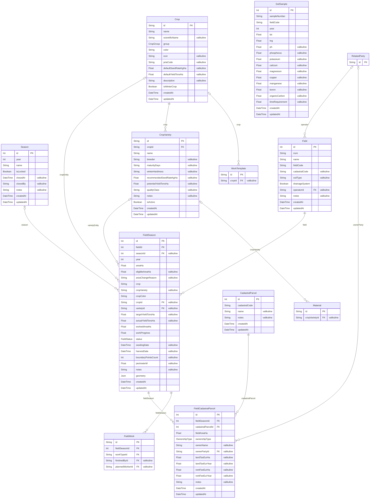
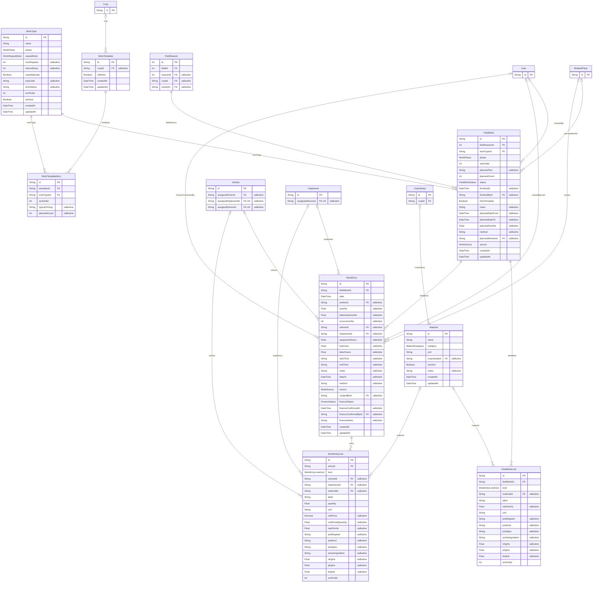
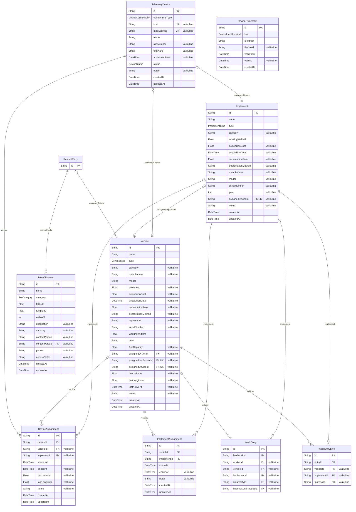
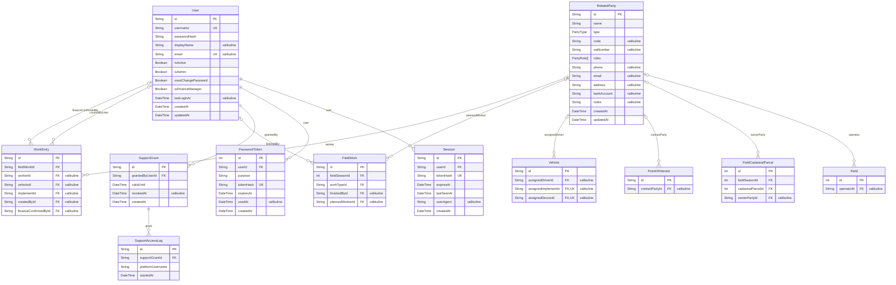
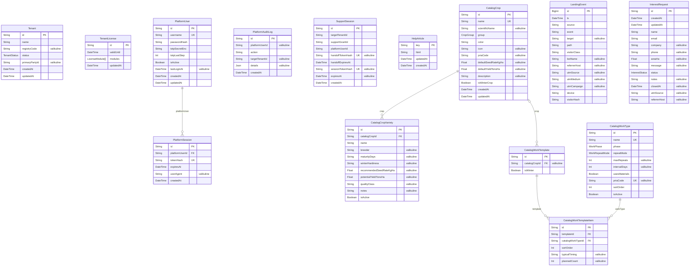

# Andmemudel (ERD)

Genereeritud skriptiga `scripts/generate-erd.mts` failist `prisma/schema.prisma` (2026-10-26). Ära muuda käsitsi — käivita `npx tsx scripts/generate-erd.mts` pärast skeemimuudatust.

**Lugemisjuhend**
- `PK` primaarvõti, `FK` võõrvõti, `UK` unikaalne; kommentaar "valikuline" tähendab, et väli võib olla tühi.
- Seose sümbolid: `||` täpselt üks, `|o` null või üks, `o{` null või mitu. Seose nimi on võõrvõtme välja nimi.
- Iga ettevõttepõhise tabeli veerg `tenant_id` (ettevõte, Postgres RLS) ning auditiveerud `createdBy`/`updatedBy` on skeemidelt välja jäetud.
- Valdkonna skeemis on teise valdkonna tabelid kuvatud ainult võtmetega.

## Sisukord
1. [Põllud, hooajad ja kultuurid](#põllud-hooajad-ja-kultuurid)
2. [Põllutööd ja kanded](#põllutööd-ja-kanded)
3. [Masinapark, telemeetria ja objektid](#masinapark-telemeetria-ja-objektid)
4. [Isikud, kasutajad ja tugi](#isikud-kasutajad-ja-tugi)
5. [Platvorm (teenusepakkuja)](#platvorm-teenusepakkuja)
6. [Kõik seosed (ülevaade)](#kõik-seosed-ülevaade)
7. [Loendid (enum)](#loendid-enum)

## Põllud, hooajad ja kultuurid

Põld on püsiv kirje; iga hooaja andmed (pindala, kultuur, piir, saak) on eraldi hooaja põllu kirjes. Katastriüksused seotakse hooaja põlluga koos omandi ja kuludega.

| Mudel | Tabel | Ettevõttepõhine | Sisu |
|---|---|---|---|
| `Season` | `seasons` | jah | Hooaeg (aasta); lukustatud hooaja andmeid ei muudeta |
| `Field` | `fields` | jah | Põld (püsiv): PRIA põllu nr, massiiv, nimi, operaator |
| `FieldSeason` | `field_seasons` | jah | Põllu hooaja andmed: pindala, kultuur, sort, piir (GeoJSON), saak, staatus |
| `CadastralParcel` | `cadastral_parcels` | jah | Katastriüksus (tunnus, nimi) |
| `FieldCadastralParcel` | `field_cadastral_parcels` | jah | Hooaja põllu ja katastriüksuse seos: põllu osa pindala, omand/rent, maamaks, rent |
| `Crop` | `crops` | jah | Kultuur (ettevõtte register; PRIA kood, talivili, värv) |
| `CropVariety` | `crop_varieties` | jah | Sort kultuuri all |
| `SoilSample` | `soil_samples` | jah | Mullaproov (pH, P, K, Ca, Mg, Corg; asukoht) |

- Mullaproovid seotakse põlluga massiivi numbri järgi (`fieldCode`) ja kaardil asukoha järgi, mitte võõrvõtmega.

## Põllutööd ja kanded

Töö on hooaja põllu planeeritud tegevus (PRIA tegevus), plaaniread on planeeritud materjalid normiga. Kanne on tegelikult tehtud töö osa; kande read on tööaeg, masin, kütus, materjalid, saak ja seire leiud.

| Mudel | Tabel | Ettevõttepõhine | Sisu |
|---|---|---|---|
| `WorkType` | `work_types` | jah | Töötüüp = PRIA tegevus (29), faas, lühinimi |
| `FieldWork` | `field_works` | jah | Töö (plaan) hooaja põllul: kuupäevad, pindala, viis, teostaja, staatus, allikas |
| `FieldWorkLine` | `field_work_lines` | jah | Töö plaanirida: planeeritud materjal (norm/ha, PRIA atribuudid) või saak |
| `WorkEntry` | `work_entries` | jah | Kanne = tehtud töö osa: kuupäev, töötaja, masin, haakeriist, tunnid, kütus, pindala, finantsi olek |
| `WorkEntryLine` | `work_entry_lines` | jah | Kande rida: tööaeg, masin, haakeriist, kütus, materjal, saak, seire leid (kogus, ühik, hind) |
| `Material` | `materials` | jah | Kulumaterjal (seeme, väetis, taimekaitsevahend, muu) |
| `WorkTemplate` | `work_templates` | jah | Tööde mall (kasutuseta) |
| `WorkTemplateItem` | `work_template_items` | jah | Tööde malli rida (kasutuseta) |

- Töötüübid = PRIA e-põlluraamatu 29 tegevust (`priaCode`); `shortName` on ettevõtte lühinimi.
- `WorkTemplate` ja `WorkTemplateItem` (tööde mallid) on andmebaasis alles, aga rakendus neid enam ei kasuta.

## Masinapark, telemeetria ja objektid

Masinad, haakeriistad ja telemeetriaseadmed. Seadme omand (ettevõttele kuulumise periood) ja paigaldus masinale/haakeriistale on ajaliste kirjetena; telemeetria mõõtmised ise on eraldi telemeetria andmebaasis.

| Mudel | Tabel | Ettevõttepõhine | Sisu |
|---|---|---|---|
| `Vehicle` | `vehicles` | jah | Masin (traktor, kombain jm): andmed, amortisatsioon, viimane asukoht, juht |
| `Implement` | `implements` | jah | Haakeriist (laius, tüüp) |
| `TelemetryDevice` | `telemetry_devices` | jah | Telemeetriaseade (IMEI vms) |
| `DeviceOwnership` | `device_ownerships` | jah | Seadme kuulumine ettevõttele ajavahemikus |
| `DeviceAssignment` | `device_assignments` | jah | Seadme paigaldus masinale/haakeriistale ajavahemikus |
| `ImplementAssignment` | `implement_assignments` | jah | Haakeriista ühendus masinaga ajavahemikus |
| `PointOfInterest` | `points_of_interest` | jah | Objekt (kuivati, ladu, töökoda jm): asukoht, raadius, kontakt |

- Telemeetria (GPS, süüde, kiirus jm) on eraldi TimescaleDB andmebaasis (`measurements`), seotud seadme IMEI kaudu.

## Isikud, kasutajad ja tugi

Seotud isikud (töötajad, omanikud, operaatorid, partnerid) ja rakenduse kasutajad. Tugiligipääs lubab teenusepakkujal ettevõtte andmeid ajutiselt vaadata.

| Mudel | Tabel | Ettevõttepõhine | Sisu |
|---|---|---|---|
| `RelatedParty` | `related_parties` | jah | Seotud isik/ettevõte: töötaja, omanik, operaator, partner |
| `User` | `users` | jah | Rakenduse kasutaja (ettevõtte), rollid |
| `Session` | `sessions` | – | Kasutaja sessioon |
| `PasswordToken` | `password_tokens` | – | Parooli seadmise / kutse token |
| `SupportGrant` | `support_grants` | jah | Ettevõtte antud tugiligipääs teenusepakkujale |
| `SupportAccessLog` | `support_access_log` | jah | Tugiligipääsu logi |

## Platvorm (teenusepakkuja)

Ettevõtted, litsentsid, platvormi kasutajad, algkataloog uue ettevõtte jaoks, abiartiklid ja landing-lehe andmed. Need tabelid ei ole ettevõttepõhised.

| Mudel | Tabel | Ettevõttepõhine | Sisu |
|---|---|---|---|
| `Tenant` | `tenants` | – | Ettevõte (klient) |
| `TenantLicense` | `tenant_licenses` | jah | Ettevõtte litsents ja moodulid |
| `PlatformUser` | `platform_users` | – | Teenusepakkuja (admin.teris.ee) kasutaja |
| `PlatformSession` | `platform_sessions` | – | Platvormi kasutaja sessioon |
| `PlatformAuditLog` | `platform_audit_log` | – | Platvormi tegevuste logi |
| `SupportSession` | `support_sessions` | – | Tugiligipääsu sessioon |
| `HelpArticle` | `help_articles` | – | Abiartikkel (kasutusjuhend) |
| `CatalogCrop` | `catalog_crops` | – | Algkataloogi kultuur (kopeeritakse uuele ettevõttele) |
| `CatalogCropVariety` | `catalog_crop_varieties` | – | Algkataloogi sort |
| `CatalogWorkType` | `catalog_work_types` | – | Algkataloogi töötüüp (PRIA tegevus) |
| `CatalogWorkTemplate` | `catalog_work_templates` | – | Algkataloogi mall (kasutuseta) |
| `CatalogWorkTemplateItem` | `catalog_work_template_items` | – | Algkataloogi malli rida (kasutuseta) |
| `LandingEvent` | `landing_events` | – | Landing-lehe külastuse sündmus |
| `InterestRequest` | `interest_requests` | – | Landing-lehe huvipäring |

## Kõik seosed (ülevaade)

Kõik tabelid ja nende seosed ühel skeemil (ilma veergudeta).

```mermaid
erDiagram
  RelatedParty |o--o{ Field : "operator"
  Field ||--o{ FieldSeason : "field"
  Season |o--o{ FieldSeason : "season"
  Crop |o--o{ FieldSeason : "cropEntity"
  CropVariety |o--o{ FieldSeason : "varietyEntity"
  FieldSeason ||--o{ FieldCadastralParcel : "fieldSeason"
  CadastralParcel ||--o{ FieldCadastralParcel : "cadastralParcel"
  RelatedParty |o--o{ FieldCadastralParcel : "ownerParty"
  RelatedParty |o--o{ PointOfInterest : "contactParty"
  RelatedParty |o--o{ Vehicle : "assignedDriver"
  Implement |o--o| Vehicle : "assignedImplement"
  TelemetryDevice |o--o| Vehicle : "assignedDevice"
  TelemetryDevice |o--o| Implement : "assignedDevice"
  TelemetryDevice ||--o{ DeviceAssignment : "device"
  Vehicle |o--o{ DeviceAssignment : "vehicle"
  Implement |o--o{ DeviceAssignment : "implement"
  Vehicle ||--o{ ImplementAssignment : "vehicle"
  Implement ||--o{ ImplementAssignment : "implement"
  Crop ||--o{ CropVariety : "crop"
  CropVariety |o--o{ Material : "cropVariety"
  Crop |o--o{ WorkTemplate : "crop"
  WorkTemplate ||--o{ WorkTemplateItem : "template"
  WorkType ||--o{ WorkTemplateItem : "workType"
  FieldSeason ||--o{ FieldWork : "fieldSeason"
  WorkType ||--o{ FieldWork : "workType"
  User |o--o{ FieldWork : "finishedBy"
  RelatedParty |o--o{ FieldWork : "plannedWorker"
  FieldWork ||--o{ FieldWorkLine : "fieldWork"
  Material |o--o{ FieldWorkLine : "material"
  FieldWork ||--o{ WorkEntry : "fieldWork"
  RelatedParty |o--o{ WorkEntry : "worker"
  Vehicle |o--o{ WorkEntry : "vehicle"
  Implement |o--o{ WorkEntry : "implement"
  User |o--o{ WorkEntry : "createdByUser"
  User |o--o{ WorkEntry : "financeConfirmedBy"
  WorkEntry ||--o{ WorkEntryLine : "entry"
  Vehicle |o--o{ WorkEntryLine : "vehicle"
  Implement |o--o{ WorkEntryLine : "implement"
  Material |o--o{ WorkEntryLine : "material"
  User ||--o{ Session : "user"
  User ||--o{ SupportGrant : "grantedBy"
  SupportGrant ||--o{ SupportAccessLog : "grant"
  User ||--o{ PasswordToken : "user"
  PlatformUser ||--o{ PlatformSession : "platformUser"
  CatalogCrop ||--o{ CatalogCropVariety : "crop"
  CatalogCrop |o--o{ CatalogWorkTemplate : "crop"
  CatalogWorkTemplate ||--o{ CatalogWorkTemplateItem : "template"
  CatalogWorkType ||--o{ CatalogWorkTemplateItem : "workType"
```

## Loendid (enum)

| Loend | Väärtused |
|---|---|
| `FieldStatus` | `NOT_STARTED`, `IN_PROGRESS`, `COMPLETED` |
| `PoiCategory` | `DRYER`, `WATER_SOURCE`, `WORKSHOP`, `FUEL_STATION`, `FIELD_ENTRANCE`, `STORAGE`, `SCALE`, `OTHER` |
| `VehicleType` | `TRACTOR`, `COMBINE`, `SPRAYER`, `SPREADER`, `TRUCK`, `ATV`, `LOADER` |
| `ImplementType` | `CULTIVATOR`, `SEEDER`, `SPRAYER`, `HEADER`, `DISC_HARROW`, `PLOW`, `MOWER`, `TRAILER`, `FERTILIZER_SPREADER`, `ROLLER`, `OTHER` |
| `DeviceStatus` | `WORKING`, `MOVING`, `STOPPED`, `IDLING`, `OFFLINE` |
| `OwnershipType` | `OWNED`, `RENTED` |
| `PartyType` | `PERSON`, `LEGAL_ENTITY` |
| `PartyRole` | `LANDOWNER`, `DRIVER`, `OPERATOR`, `OTHER` |
| `DeviceConnectivity` | `CELLULAR`, `EYE_SENSOR` |
| `DeviceIdentifierKind` | `IMEI`, `MAC` |
| `CropGroup` | `CEREAL`, `OILSEED`, `LEGUME`, `FORAGE_GRASS`, `FALLOW`, `OTHER` |
| `WorkPhase` | `PREPARATION`, `SOWING`, `CARE`, `HARVEST` |
| `WorkRepeatMode` | `ONCE`, `UP_TO`, `INTERVAL` |
| `FieldWorkStatus` | `PLANNED`, `IN_PROGRESS`, `DONE` |
| `WorkEntryLineKind` | `LABOR`, `MACHINE`, `IMPLEMENT`, `FUEL`, `MATERIAL`, `HARVEST`, `OBSERVATION` |
| `FinanceStatus` | `PENDING`, `CONFIRMED`, `CHANGED` |
| `WorkSource` | `MANUAL`, `PRIA_IMPORT` |
| `MaterialCategory` | `SEED`, `FERTILIZER`, `PLANT_PROTECTION`, `OTHER` |
| `TenantStatus` | `ACTIVE`, `SUSPENDED` |
| `LicenseModule` | `TELEMETRY`, `SATELLITE`, `WEATHER` |
| `InterestStatus` | `NEW`, `CONTACTED`, `CLOSED` |
