# Vaated, komponendid ja andmed

See dokument näitab, millised TERISe vaated ja komponendid kuvavad, lisavad, muudavad või kustutavad andmeid millistes andmebaasi tabelites. Ahel on alati sama: **vaade → komponent → API päring (`src/services/api.ts`) → serveri käsitleja (`src/server/*`) → Prisma mudel (tabel)**. Mudelite ja tabelite nimed on samad mis andmemudeli dokumendis [andmemudel.md](andmemudel.md).

Koostatud koodi põhjal 26.10.2026, uuendada käsitsi koodimuudatuste järel.

**Lugemisjuhend**
- `R` = loeb, `C` = lisab, `U` = muudab, `D` = kustutab.
- Tabelid on toodud Prisma mudeli nimega (nt `FieldSeason` = tabel `field_seasons`).
- „Kaskaad“ tähendab, et kustutamise teeb andmebaas võõrvõtme reegli (`onDelete: Cascade`) järgi; „nullimine“ tähendab, et seotud kirjetes pannakse viide tühjaks (`onDelete: SetNull`), mida loetakse muutmiseks (`U`).
- `tsdb measurements` on telemeetria eraldi andmebaas (TimescaleDB), mitte Prisma mudel.
- Iga sisselogitud päring loeb lisaks sessiooni (`Session` R, aeg-ajalt U libiseva aegumise jaoks, ja `User` U viimase sisselogimise aja jaoks), ettevõtte oleku (`Tenant` R) ja litsentsi (`TenantLicense` R). Neid ei korrata allpool iga vaate juures.
- Ettevõtte piiritlus (`tenant_id`, RLS) ja auditiveerud (`createdBy`/`updatedBy`) täidetakse serveris automaatselt ega ole tabelites eraldi välja toodud.

## Sisukord
1. [Ülevaade](#ülevaade)
2. [Kaart](#kaart)
3. [Põllu aken (täisvaade) ja selle dialoogid](#põllu-aken-täisvaade-ja-selle-dialoogid)
4. [Hooajad](#hooajad)
5. [Põllud ja impordid](#põllud-ja-impordid)
6. [Kultuurid](#kultuurid)
7. [Külvikord](#külvikord)
8. [Põllutööd ja finantsid](#põllutööd-ja-finantsid)
9. [Kulumaterjalid](#kulumaterjalid)
10. [Tehnika (masinapark)](#tehnika-masinapark)
11. [Taristu](#taristu)
12. [Isikud](#isikud)
13. [Konto: sisselogimine, kasutajad ja kasutajatugi](#konto-sisselogimine-kasutajad-ja-kasutajatugi)
14. [Platvormi haldus (admin.teris.ee)](#platvormi-haldus-adminterisee)
15. [Avaleht (landing)](#avaleht-landing)
16. [API → tabelid](#api--tabelid)
17. [CRUD-maatriks](#crud-maatriks)
18. [Rakenduse käivitusel laetavad andmed](#rakenduse-käivitusel-laetavad-andmed)
19. [Tähelepanekud ja ebakindlused](#tähelepanekud-ja-ebakindlused)

## Ülevaade

Põhivaated on ülamenüüs (`MAIN_VIEWS` failis `src/components/Header.tsx`), vaade valitakse failis `src/App.tsx` (`mainView`). Kaart jääb alati mällu (peidetakse), teised vaated laaditakse vajadusel eraldi tükina (`lazy`).

| Vaade | Peakomponent | Kirjeldus | Peamised tabelid |
|---|---|---|---|
| Kaart (`map`) | `MapView` + `LayerControl`, `MapYearSelector`, `SatellitePanel`, `CultivationControl` | Põllud, objektid, mullaproovid, masinad ja nende rajad kaardil; sajuradar ja satelliidipilt | `Field`, `FieldSeason`, `PointOfInterest`, `SoilSample`, `Vehicle`, `TelemetryDevice`, `DeviceAssignment`, tsdb (kõik R) |
| Põllu aken | `FieldFullView` (+ `FieldEditDialog`, `FieldWorkPlanDialog`, `FieldWorkEntryDialog`) | Ühe põllu hooaja ülevaade, tööd ja kanded; avaneb kaardilt või põldude/külvikorra registrist | `FieldSeason`, `FieldWork`, `WorkEntry` (RCU), `Field` (RU) |
| Hooajad (`seasons`) | `SeasonManagerModal` (täisleht) | Hooaegade loomine, muutmine, lukustamine ja avamine | `Season` (RCU) |
| Põllud (`fields`) | `FieldsTableView` (+ `FieldEditDialog`, impordiaknad) | Põldude register, põllu muutmine ja kustutamine, PRIA põldude, mullaproovide ja põlluraamatu import | `Field`, `FieldSeason`, `FieldCadastralParcel` (RCUD), `SoilSample`, `FieldWork`, `WorkEntry` (import) |
| Kultuurid (`crops`) | `CropRegisterModal` (täisleht) | Kultuuride ja sortide register | `Crop`, `CropVariety` (RCUD), `FieldSeason` (U värv) |
| Külvikord (`rotation`) | `FieldManagerModal` (täisleht) + `FieldShapeModal` | Põldude kultuurid aastate kaupa | `FieldSeason` (RCU), `Field` (RU) |
| Põllutööd (`works`) | `FieldWorksBoard` (+ `AddFieldWorkDialog`, `FieldWorkPlanForm`, `FieldWorkEntryDialog`, `FinanceModal`, `WorkRegisterModal`) | Hooaja tööde tahvel, plaanid, kanded, finantside kinnitamine, tööliikide register | `FieldWork`, `FieldWorkLine`, `WorkEntry`, `WorkEntryLine`, `WorkType`, `Material` (RCUD) |
| Kulumaterjalid (`materials`) | `MaterialsView` (+ `MaterialFormDialog`) | Materjalide register koos hooaja plaanitud ja kasutatud kogustega | `Material` (RCUD), `FieldWorkLine`, `WorkEntryLine` (R) |
| Tehnika (`fleet`) | `VehicleTracker` (täisleht) + `DeviceAssignmentRegister` | Masinad, haakeriistad, telemeetriaseadmed, haakimise ja seadmete seoste registrid | `Vehicle`, `Implement`, `TelemetryDevice`, `ImplementAssignment`, `DeviceAssignment` (RCUD), `DeviceOwnership` (RCU) |
| Taristu (`infrastructure`) | `PoiManagerModal` (täisleht) | Muud asukohad (kuivatid, laod, tanklad jm) | `PointOfInterest` (RCUD) |
| Isikud (`parties`) | `RelatedPartiesModal` (täisleht) | Seotud isikud: maaomanikud, rentnikud, masinajuhid, partnerid | `RelatedParty` (RCUD) |
| Konto (päise kasutajamenüü, sisselogimine) | `AuthGate`, `LoginPage`, `SetPasswordPage`, `UserMenu`, `ChangePasswordModal`, `UsersAdminModal`, `SupportAccessPanel` | Sisselogimine, parooli määramine ja vahetus, kasutajate haldus, kasutajatoe ligipääs | `User`, `Session`, `PasswordToken`, `SupportGrant` (RCUD) |
| Platvormi haldus | `src/admin/AdminApp.tsx` (eraldi rakendus `admin.html`) | Teenusepakkuja: ettevõtted, litsentsid, kataloog, seadmed, juhendid, huvilised, audit | `Tenant`, `TenantLicense`, `Catalog*`, `HelpArticle`, `PlatformAuditLog` jt |
| Avaleht | `landing.html` (`src/landing/*`) | Avalik tutvustusleht: külastuste loendus ja huviliste vorm | `LandingEvent`, `InterestRequest` (C) |

## Kaart

Kaardivaade kuvab käivitusel laetud andmeid (põllud valitud hooaja järgi, objektid, mullaproovid, masinate register). Telemeetria, satelliidi ja ilma osad laaditakse alles siis, kui kasutaja vastava kihi sisse lülitab, ja ainult siis, kui ettevõtte litsentsis on vastav moodul (`TELEMETRY`, `SATELLITE`, `WEATHER`). Kaardilt otse andmeid ei muudeta; objekti asukoha valimine kaardil lõpeb Taristu vaates salvestamisega.

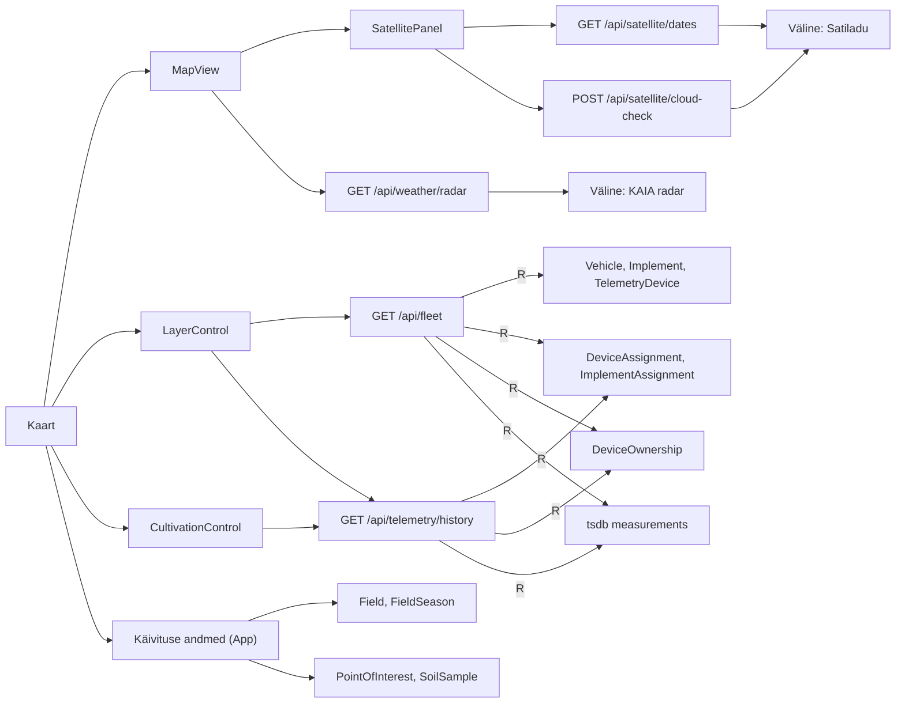

| Komponent | Tegevus (kasutaja vaates) | API | Tabelid (R/C/U/D) |
|---|---|---|---|
| `MapView` | näitab valitud hooaja põlde, objekte, mullaproove ja masinaid | (käivituse andmed, vt allpool) | `Field` R, `FieldSeason` R, `PointOfInterest` R, `SoilSample` R, `Vehicle` R |
| `LayerControl` (kiht „Tehnika“) | lülitab masinate kihi sisse → loeb seadmete viimased asukohad | `GET /api/fleet` | `Vehicle` R, `RelatedParty` R (juht), `Implement` R, `TelemetryDevice` R, `DeviceAssignment` R, `ImplementAssignment` R, `DeviceOwnership` R, tsdb R |
| `LayerControl` (kiht „Põllutööd“) | näitab kõigi masinate viimase ≥ 48 h rajad | `GET /api/telemetry/history` (iga masina kohta) | `DeviceAssignment` R, `TelemetryDevice` R, `ImplementAssignment` R, `Implement` R, `DeviceOwnership` R, tsdb R |
| `CultivationControl` | ühe masina raja taasesitus valitud ajavahemikus | `GET /api/telemetry/history` | nagu eelmine |
| `MapView` (sajuradar) | sajuradari kaadrid | `GET /api/weather/radar`, `GET /api/weather/radar.png` | andmebaasi ei kasuta (väline KAIA teenus, serveri vahemälu) |
| `SatellitePanel` | satelliidipiltide kuupäevad ja pilvisus põldude kohal | `GET /api/satellite/dates`, `POST /api/satellite/cloud-check` | andmebaasi ei kasuta (väline Satiladu); pildikihid laaditakse brauserist otse Maa- ja Ruumiameti teenusest |
| `MapYearSelector` | hooaja valik ja kultuuride legend | — | `Season` R, `FieldSeason` R (käivituse andmetest) |

## Põllu aken (täisvaade) ja selle dialoogid

`FieldFullView` avaneb kaardil põllu klõpsamisel või põldude/külvikorra registrist („Ava põld“). Aken laeb põllu valitud hooaja tööd ja kanded. Nupud avavad App-taseme dialoogid: põllu muutmine (`FieldEditDialog`), töö plaan (`FieldWorkPlanDialog` → `FieldWorkPlanForm`) ja kanne (`FieldWorkEntryDialog`). Esimese plaani- või kandedialoogi avamisel laetakse tööliigid ja materjalid. Mullaproovid tulevad käivituse andmetest, NDVI arvutatakse brauseris satelliidipildist.

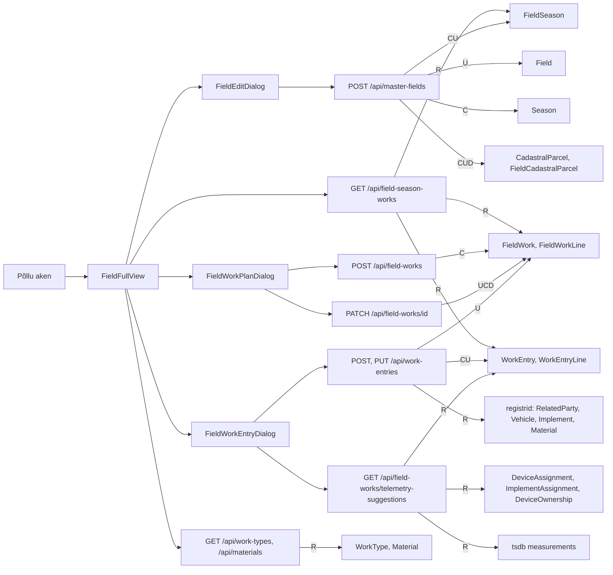

| Komponent | Tegevus (kasutaja vaates) | API | Tabelid (R/C/U/D) |
|---|---|---|---|
| `FieldFullView` | näitab põllu hooaja andmeid, töid ja kandeid | `GET /api/field-season-works` | `FieldSeason` R, `FieldWork` R, `WorkType` R, `FieldWorkLine` R, `WorkEntry` R, `WorkEntryLine` R, `RelatedParty` R, `Vehicle` R, `Implement` R |
| `FieldOverviewPanel` / `SoilSamplesSection` / `FieldNdviSection` | mullaproovid ja NDVI | — (käivituse andmed, väline satelliidipilt) | `SoilSample` R |
| `FieldEditDialog` | muudab põllu põhiandmeid ja hooaja andmeid (pindala, kultuur, sort, katastriüksused) | `POST /api/master-fields` (üks põld) | `Field` RU, `FieldSeason` CU (kõik põllu aastad), `Season` C (puuduv hooaeg), `CadastralParcel` CU, `FieldCadastralParcel` CUD |
| `FieldWorkPlanDialog` (`FieldWorkPlanForm`) | lisab või muudab töö plaani (kuupäevad, pindala, plaaniread) | `POST /api/field-works`, `PATCH /api/field-works/:id` | `WorkType` R, `FieldWork` RCU, `FieldWorkLine` CD (read asendatakse), `WorkEntry` R |
| `FieldWorkEntryDialog` | lisab või muudab kande (tegelik töö, materjalid, tunnid, saak) | `POST /api/work-entries`, `PUT /api/work-entries/:id` | `WorkEntry` RCU, `WorkEntryLine` CD, `FieldWork` RU (olek), `RelatedParty` R, `Vehicle` R, `Implement` R, `Material` R |
| `FieldWorkEntryDialog` | pakub telemeetriast sõite kande täitmiseks | `GET /api/field-works/telemetry-suggestions` | `FieldSeason` R, `WorkEntry` R, `DeviceAssignment` R, `TelemetryDevice` R, `Vehicle` R, `RelatedParty` R, `Implement` R, `ImplementAssignment` R, `DeviceOwnership` R, `Field` R, `PointOfInterest` R, tsdb R |
| App (`ensureWorkRefs`) | laeb dialoogide valikud | `GET /api/work-types`, `GET /api/materials` | `WorkType` R, `FieldWork` R (loend), `Material` R, `WorkEntryLine` R (loend) |

## Hooajad

Hooaegade leht (`SeasonManagerModal`, `isFullPage`) kasutab käivitusel laetud hooaegu ja põlde. Salvestamise järel loetakse hooajad uuesti, sest sulgemise aja ja sulgeja paneb server.

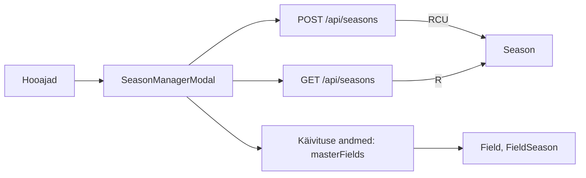

| Komponent | Tegevus (kasutaja vaates) | API | Tabelid (R/C/U/D) |
|---|---|---|---|
| `SeasonManagerModal` | loob uue hooaja | `POST /api/seasons`, seejärel `GET /api/seasons` | `Season` RC |
| `SeasonManagerModal` | muudab hooaja nime või märkusi | `POST /api/seasons` | `Season` U |
| `SeasonManagerModal` | lukustab või avab hooaja (server paneb või eemaldab sulgemise aja ja sulgeja) | `POST /api/seasons` | `Season` U |
| `SeasonManagerModal` | näitab hooaja põldude arvu ja pindala | — | `Field` R, `FieldSeason` R (käivituse andmetest) |

## Põllud ja impordid

Põldude tabel (`FieldsTableView`) avab põllu muutmise dialoogi, põllu akna ning (ainult adminile) impordiaknad. Siit avatakse ka Isikute ja Kultuuride registri aknad (vt nende jaotisi).

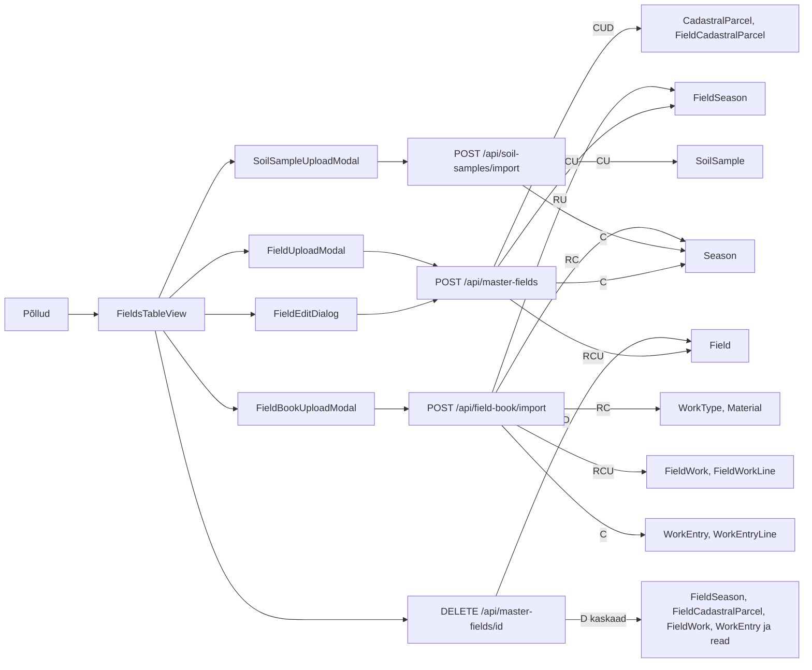

| Komponent | Tegevus (kasutaja vaates) | API | Tabelid (R/C/U/D) |
|---|---|---|---|
| `FieldsTableView` | näitab põlde valitud hooaja andmetega, operaatori filtriga | — (käivituse andmed) | `Field` R, `FieldSeason` R, `RelatedParty` R, `Crop` R |
| `FieldEditDialog` | muudab põldu (põhiandmed + kõigi aastate hooajakirjed + katastriüksused) | `POST /api/master-fields` | `Field` RU, `FieldSeason` CU, `Season` C, `CadastralParcel` CU, `FieldCadastralParcel` CUD |
| `FieldsTableView` | kustutab põllu „koos kõigi aastate andmetega“ (looja või admin) | `DELETE /api/master-fields/:id` | `Field` RD; kaskaad: `FieldSeason`, `FieldCadastralParcel`, `FieldWork`, `FieldWorkLine`, `WorkEntry`, `WorkEntryLine` D |
| `FieldUploadModal` (admin) | impordib PRIA põldude SHP-faili valitud aastasse | `POST /api/master-fields` (massiiv), seejärel `GET /api/master-fields`, `GET /api/seasons` | `Field` RCU, `FieldSeason` CU (ainult imporditud aasta), `Season` C |
| `SoilSampleUploadModal` (admin) | impordib mullaproovid | `POST /api/soil-samples/import` | `SoilSample` CU (proovi numbri järgi), `Season` C |
| `FieldBookUploadModal` (admin) | impordib e-PRIA põlluraamatu: loob või täiendab töid ja kandeid, saagid ja kuupäevad hooajale | `POST /api/field-book/import`, seejärel `GET /api/master-fields`, `GET /api/seasons` | `Season` RC, `Field` R, `FieldSeason` RU, `WorkType` RC, `Material` RC, `FieldWork` RCU, `FieldWorkLine` C, `WorkEntry` C, `WorkEntryLine` C |

## Kultuurid

Kultuuride leht (`CropRegisterModal`) haldab kultuure ja nende sorte. Sordid salvestatakse koos kultuuriga täisnimekirjana. Sama akent saab avada ka põldude vaatest ja põllu muutmise dialoogist.

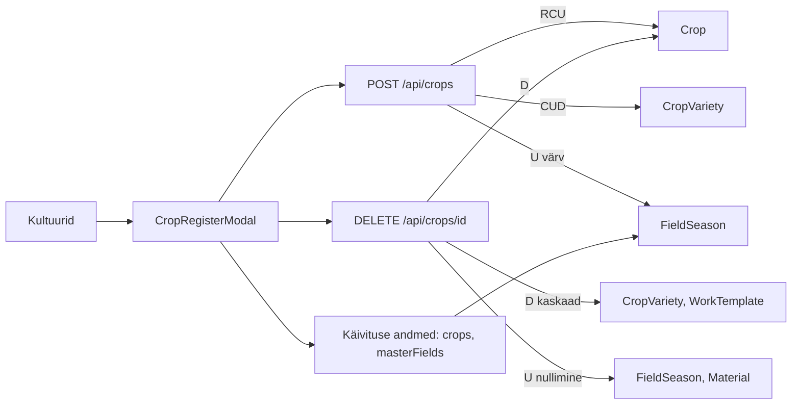

| Komponent | Tegevus (kasutaja vaates) | API | Tabelid (R/C/U/D) |
|---|---|---|---|
| `CropRegisterModal` | näitab kultuure, sorte ja kultuuride pindala valitud hooajal | — (käivituse andmed) | `Crop` R, `CropVariety` R, `FieldSeason` R |
| `CropRegisterModal` | lisab või muudab kultuuri koos sortidega | `POST /api/crops` | `Crop` RCU, `CropVariety` CUD (nimekirjast puuduvad kustutatakse); värvi muutmisel `FieldSeason` U (sama kultuuri hooajakirjete värv) |
| `CropRegisterModal` | kustutab kultuuri (looja või admin) | `DELETE /api/crops/:id` | `Crop` RD; kaskaad: `CropVariety`, `WorkTemplate` (ja `WorkTemplateItem`) D; nullimine: `FieldSeason` U, `Material` U |

## Külvikord

Külvikorra leht (`FieldManagerModal`) näitab põldude kultuure aastate kaupa ja võimaldab hooaja kultuuri ja sorti muuta. `FieldShapeModal` näitab põllu kuju (ainult lugemiseks).

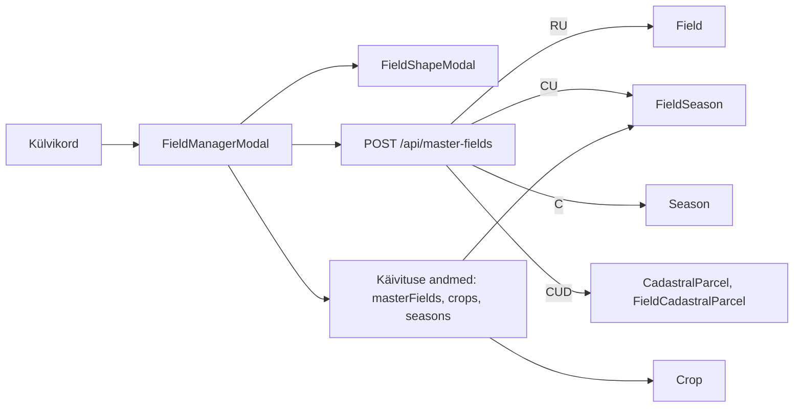

| Komponent | Tegevus (kasutaja vaates) | API | Tabelid (R/C/U/D) |
|---|---|---|---|
| `FieldManagerModal` | näitab põldude kultuure aastate kaupa | — (käivituse andmed) | `Field` R, `FieldSeason` R, `Crop` R, `Season` R |
| `FieldManagerModal` | muudab või tühjendab põllu hooaja kultuuri ja sordi | `POST /api/master-fields` | `Field` RU, `FieldSeason` CU, `Season` C, `CadastralParcel` CU, `FieldCadastralParcel` CUD (kogu põllu ajalugu saadetakse uuesti) |
| `FieldShapeModal` | näitab põllu piiri | — | `FieldSeason` R |

## Põllutööd ja finantsid

Tööde tahvel (`FieldWorksBoard`) laeb valitud hooaja tööd koos kannetega, tööliigid ja materjalid. Tahvlilt avatakse töö lisamine, plaani ja kande muutmine, finantsid (ainult admin ja finantsjuht) ning tööliikide register.

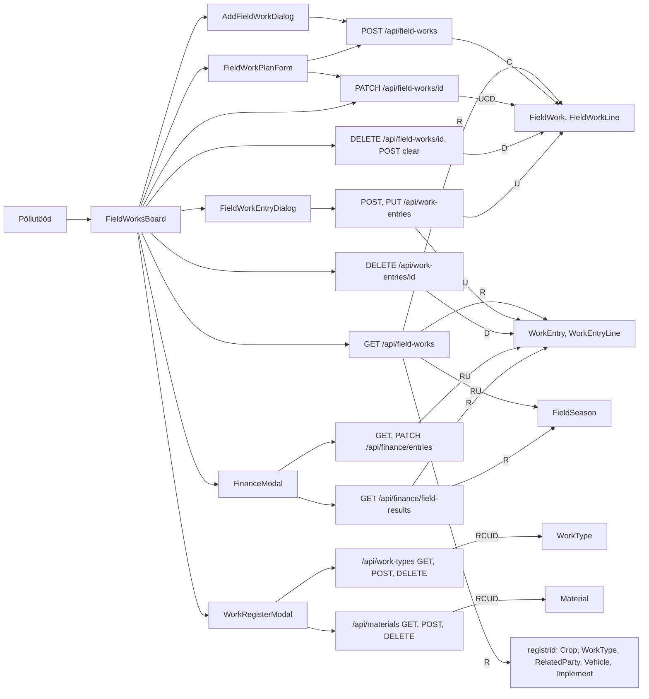

| Komponent | Tegevus (kasutaja vaates) | API | Tabelid (R/C/U/D) |
|---|---|---|---|
| `FieldWorksBoard` | näitab hooaja põldude töid (ka järgmise hooaja sügistööd) | `GET /api/field-works?year=` | `Crop` R, `FieldSeason` RU (kõrvalmõju: määramata kultuuriga põllule kirjutatakse eelmise aasta talivili, kui litsents pole aegunud), `FieldWork` R, `WorkType` R, `FieldWorkLine` R, `WorkEntry` R, `WorkEntryLine` R, `RelatedParty` R, `Vehicle` R, `Implement` R |
| `FieldWorksBoard` | laeb tööliigid ja materjalid | `GET /api/work-types`, `GET /api/materials` | `WorkType` R, `Material` R, `FieldWork` R (loend), `WorkEntryLine` R (loend) |
| `AddFieldWorkDialog` | lisab põllule töö | `POST /api/field-works` | `WorkType` R, `FieldWork` RC, `FieldWorkLine` C |
| `FieldWorkPlanForm` | muudab töö plaani | `PATCH /api/field-works/:id` | `FieldWork` RU, `FieldWorkLine` CD, `WorkEntry` R |
| `FieldWorksBoard` | märgib töö tehtuks või avab uuesti | `PATCH /api/field-works/:id` (`status`) | `FieldWork` U, `WorkEntry` R |
| `FieldWorksBoard` | eemaldab töö (kui kandeid pole; looja või admin) | `DELETE /api/field-works/:id` | `FieldWork` RD, `WorkEntry` R; kaskaad: `FieldWorkLine` D |
| `FieldWorksBoard` | eemaldab põllu kõik / sügis- / valitud tööd (kui kandeid pole) | `POST /api/field-works/clear` | `FieldSeason` R, `Season` R, `WorkEntry` R, `FieldWork` RD; kaskaad: `FieldWorkLine` D |
| `FieldWorkEntryDialog` | lisab või muudab kande; telemeetria soovitused | `POST`/`PUT /api/work-entries`, `GET /api/field-works/telemetry-suggestions` | vt [Põllu aken](#põllu-aken-täisvaade-ja-selle-dialoogid) |
| `FieldWorksBoard` | kustutab kande (looja või admin; kinnitatud kande ainult finantsjuht) | `DELETE /api/work-entries/:id` | `WorkEntry` RD, `FieldWork` U (olek); kaskaad: `WorkEntryLine` D |
| `FinanceModal` | näitab kandeid ja nende ridu | `GET /api/finance/entries` | `FieldSeason` R, `WorkEntry` R, `WorkEntryLine` R, `FieldWork` R, `WorkType` R, `Field` R, `RelatedParty` R, `Vehicle` R, `Implement` R |
| `FinanceModal` | sisestab ühikuhinnad ja kinnitab kande | `PATCH /api/finance/entries/:id` | `WorkEntry` RU, `WorkEntryLine` U |
| `FinanceModal` | põldude tulemus (kinnitatud kannete kulu) | `GET /api/finance/field-results` | `Crop` R, `FieldSeason` R, `Field` R, `FieldWork` R, `WorkEntry` R, `WorkEntryLine` R |
| `WorkRegisterModal` | lisab, muudab, kustutab tööliigi | `POST /api/work-types`, `DELETE /api/work-types/:id` | `WorkType` RCUD, `FieldWork` R (kasutuse kontroll), `WorkTemplateItem` D |
| `WorkRegisterModal` (+ `MaterialFormDialog`) | lisab, muudab, kustutab materjali | `POST /api/materials`, `DELETE /api/materials/:id` | vt [Kulumaterjalid](#kulumaterjalid) |

## Kulumaterjalid

Materjalide leht (`MaterialsView`) näitab valitud hooaja plaanitud ja kasutatud kogused.

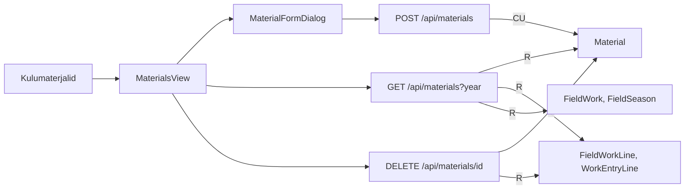

| Komponent | Tegevus (kasutaja vaates) | API | Tabelid (R/C/U/D) |
|---|---|---|---|
| `MaterialsView` | näitab materjale, hooaja plaanitud ja kasutatud koguseid | `GET /api/materials?year=` | `Material` R, `FieldWorkLine` R, `WorkEntryLine` R, `FieldWork` R, `FieldSeason` R |
| `MaterialFormDialog` | lisab või muudab materjali | `POST /api/materials` | `Material` CU |
| `MaterialsView` | kustutab materjali (looja või admin; kui kannetes pole kasutusel) | `DELETE /api/materials/:id` | `Material` RD, `WorkEntryLine` R |

## Tehnika (masinapark)

Tehnika leht (`VehicleTracker`, `isFullPage`) haldab masinaid, haakeriistu ja telemeetriaseadmeid. Haakimise ja seadmete seoste registrid on seoste ainus tõeallikas; pärast registri muutmist loetakse seosed uuesti (`GET /api/fleet`). Seadmete osa nõuab litsentsi moodulit `TELEMETRY`. Masinate, haakeriistade ja seadmete salvestamine käib App-taseme käsitlejate kaudu (`handleAddVehicle` jt).

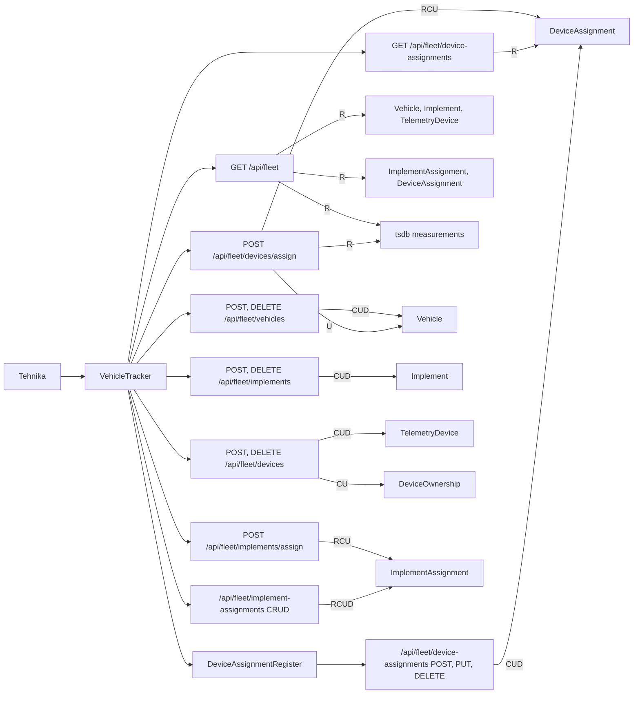

| Komponent | Tegevus (kasutaja vaates) | API | Tabelid (R/C/U/D) |
|---|---|---|---|
| `VehicleTracker` | näitab masinaid, haakeriistu ja seadmeid koos seoste ja viimase asukohaga | `GET /api/fleet` (avamisel ja pärast registri muutmist) | `Vehicle` R, `RelatedParty` R (juht), `Implement` R, `TelemetryDevice` R, `DeviceAssignment` R, `ImplementAssignment` R, `DeviceOwnership` R, tsdb R |
| `VehicleTracker` | lisab või muudab masina | `POST /api/fleet/vehicles` | `Vehicle` CU |
| `VehicleTracker` | kustutab masina (looja või admin) | `DELETE /api/fleet/vehicles/:id` | `Vehicle` RD, `ImplementAssignment` U (avatud kirjed lõpetatakse) ja kaskaad D; nullimine: `DeviceAssignment` U, `WorkEntry` U, `WorkEntryLine` U |
| `VehicleTracker` | lisab või muudab haakeriista | `POST /api/fleet/implements` | `Implement` CU |
| `VehicleTracker` | kustutab haakeriista (looja või admin) | `DELETE /api/fleet/implements/:id` | `Implement` RD, `ImplementAssignment` U ja kaskaad D, `Vehicle` U; nullimine: `DeviceAssignment` U, `WorkEntry` U, `WorkEntryLine` U |
| `VehicleTracker` | lisab või muudab telemeetriaseadme (IMEI/MAC kontroll, globaalne unikaalsus) | `POST /api/fleet/devices` | `TelemetryDevice` RCU, `DeviceOwnership` CU (omandiperioodi avamine/sulgemine) |
| `VehicleTracker` | kustutab seadme (looja või admin) | `DELETE /api/fleet/devices/:id` | `TelemetryDevice` RD, `DeviceOwnership` U (periood suletakse); kaskaad: `DeviceAssignment` D |
| `VehicleTracker` | haagib, vahetab või haagib lahti haakeriista (kaardi nupud) | `POST /api/fleet/implements/assign` | `ImplementAssignment` RCU |
| `VehicleTracker` (haakimise register) | näitab, lisab, muudab, kustutab haakimise kirjeid | `GET`/`POST /api/fleet/implement-assignments`, `PUT`/`DELETE /api/fleet/implement-assignments/:id` | `ImplementAssignment` RCUD, `Vehicle` R, `Implement` R |
| `VehicleTracker` | paigaldab seadme masinale või haakeriistale (kaardi „Vaheta“) | `POST /api/fleet/devices/assign` | `TelemetryDevice` R, `DeviceAssignment` RCU, `Vehicle` U (viimane asukoht), `DeviceOwnership` R, tsdb R |
| `VehicleTracker` / `DeviceAssignmentRegister` | seadmete seoste register | `GET`/`POST /api/fleet/device-assignments`, `PUT`/`DELETE /api/fleet/device-assignments/:id` | `DeviceAssignment` RCUD, `TelemetryDevice` R, `Vehicle` R, `Implement` R |

## Taristu

Taristu leht (`PoiManagerModal`, `isFullPage`) haldab muid asukohti. Asukoha valimiseks lülitub rakendus ajutiselt kaardile ja pärast klõpsu tagasi Taristu lehele. Salvestamine käib App-taseme käsitlejate kaudu.

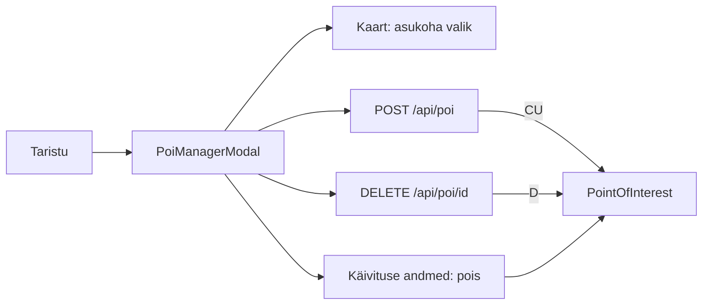

| Komponent | Tegevus (kasutaja vaates) | API | Tabelid (R/C/U/D) |
|---|---|---|---|
| `PoiManagerModal` | näitab asukohti | — (käivituse andmed, `GET /api/poi`) | `PointOfInterest` R |
| `PoiManagerModal` | lisab või muudab asukoha (nimi, liik, koordinaadid, raadius, kontakt) | `POST /api/poi` | `PointOfInterest` CU |
| `PoiManagerModal` | kustutab asukoha (looja või admin) | `DELETE /api/poi/:id` | `PointOfInterest` RD |

## Isikud

Isikute leht (`RelatedPartiesModal`, `isFullPage`) haldab seotud isikuid. Kustutamise kaitseks loendab server isiku viited (masinad, katastriüksused, objektide kontaktid, operaatori põllud). Sama akent saab avada põldude vaatest ja põllu muutmise dialoogist.

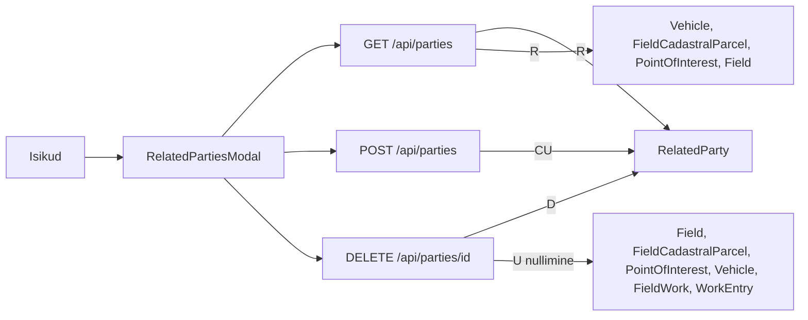

| Komponent | Tegevus (kasutaja vaates) | API | Tabelid (R/C/U/D) |
|---|---|---|---|
| `RelatedPartiesModal` | näitab isikuid koos kasutuse loenduritega ja seotud põldude/masinatega | — (käivituse andmed, `GET /api/parties`) | `RelatedParty` R, `Vehicle` R, `FieldCadastralParcel` R, `PointOfInterest` R, `Field` R |
| `RelatedPartiesModal` | lisab või muudab isiku | `POST /api/parties` | `RelatedParty` CU |
| `RelatedPartiesModal` | kustutab isiku (looja või admin) | `DELETE /api/parties/:id` | `RelatedParty` RD; nullimine: `Field` U (operaator), `FieldCadastralParcel` U (omanik), `PointOfInterest` U (kontakt), `Vehicle` U (juht), `FieldWork` U (plaanitud tegija), `WorkEntry` U (tegija) |

## Konto: sisselogimine, kasutajad ja kasutajatugi

`AuthGate` kontrollib sessiooni enne rakenduse avamist. Päise kasutajamenüü (`UserMenu`) avab parooli vahetuse ja (adminile) kasutajate halduse (`UsersAdminModal`), mille sees on kasutajatoe ligipääsu paneel (`SupportAccessPanel`).

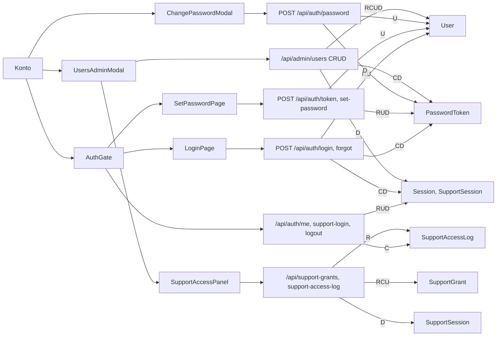

| Komponent | Tegevus (kasutaja vaates) | API | Tabelid (R/C/U/D) |
|---|---|---|---|
| `AuthGate` | kontrollib, kas kasutaja on sisse logitud | `GET /api/auth/me` | `Session` RU, `User` RU, `Tenant` R, `TenantLicense` R |
| `AuthGate` | tugivaate link teenusepakkujalt | `POST /api/auth/support-login` | `SupportSession` RUD, `SupportGrant` R, `Tenant` R, `PlatformUser` R, `SupportAccessLog` C |
| `AuthGate` / `UserMenu` | logib välja | `POST /api/auth/logout` | `Session` D, `SupportSession` D |
| `LoginPage` | logib sisse | `POST /api/auth/login` | `User` RU, `Tenant` R, `Session` CD (aegunud kustutatakse) |
| `LoginPage` | „Unustasin parooli“ → saadab lingi e-postile | `POST /api/auth/forgot` | `User` R, `Tenant` R, `PasswordToken` CD |
| `SetPasswordPage` | kontrollib kutse/lähtestuse linki ja määrab parooli | `POST /api/auth/token`, `POST /api/auth/set-password` | `PasswordToken` RUD, `User` RU, `Session` D |
| `ChangePasswordModal` | vahetab oma parooli | `POST /api/auth/password` | `User` U, `Session` D (teised sessioonid), `PasswordToken` D |
| `UsersAdminModal` | näitab kasutajaid ja viimast aktiivsust | `GET /api/admin/users` | `User` R, `Session` R |
| `UsersAdminModal` | lisab kasutaja (ja saadab kutse) | `POST /api/admin/users` | `User` RC, `PasswordToken` CD |
| `UsersAdminModal` | muudab kasutajat (nimi, e-post, rollid, aktiivsus) | `PATCH /api/admin/users/:id` | `User` RU, `Session` D (deaktiveerimisel), `PasswordToken` D |
| `UsersAdminModal` | lähtestab parooli / saadab lingi | `POST /api/admin/users/:id/password`, `POST /api/admin/users/:id/send-link` | `User` RU, `Session` D, `PasswordToken` CD |
| `UsersAdminModal` | kustutab kasutaja | `DELETE /api/admin/users/:id` | `User` RD; kaskaad: `Session`, `PasswordToken`, `SupportGrant`, `SupportAccessLog` D; nullimine: `FieldWork` U, `WorkEntry` U |
| `SupportAccessPanel` | annab kasutajatoele ajutise ligipääsu, tühistab selle, näitab sisenemiste logi | `GET`/`POST /api/support-grants`, `POST /api/support-grants/:id/revoke`, `GET /api/support-access-log` | `SupportGrant` RCU, `SupportSession` D (tühistamisel), `SupportAccessLog` R |
| `HelpHint` (Põllud, Külvikord) | näitab juhendeid | `GET /api/help` | `HelpArticle` R |

## Platvormi haldus (admin.teris.ee)

Eraldi rakendus (`admin.html`, `src/admin/*`) teenusepakkuja töötajatele. Päringud käivad `src/admin/platformApi.ts` kaudu teele `/api/platform/*` (`src/server/platformApi.ts`, `platformAuth.ts`), ettevõtte piiranguta andmebaasirolliga (`authDb`). Iga muudatus kirjutab auditilogi (`PlatformAuditLog` C).

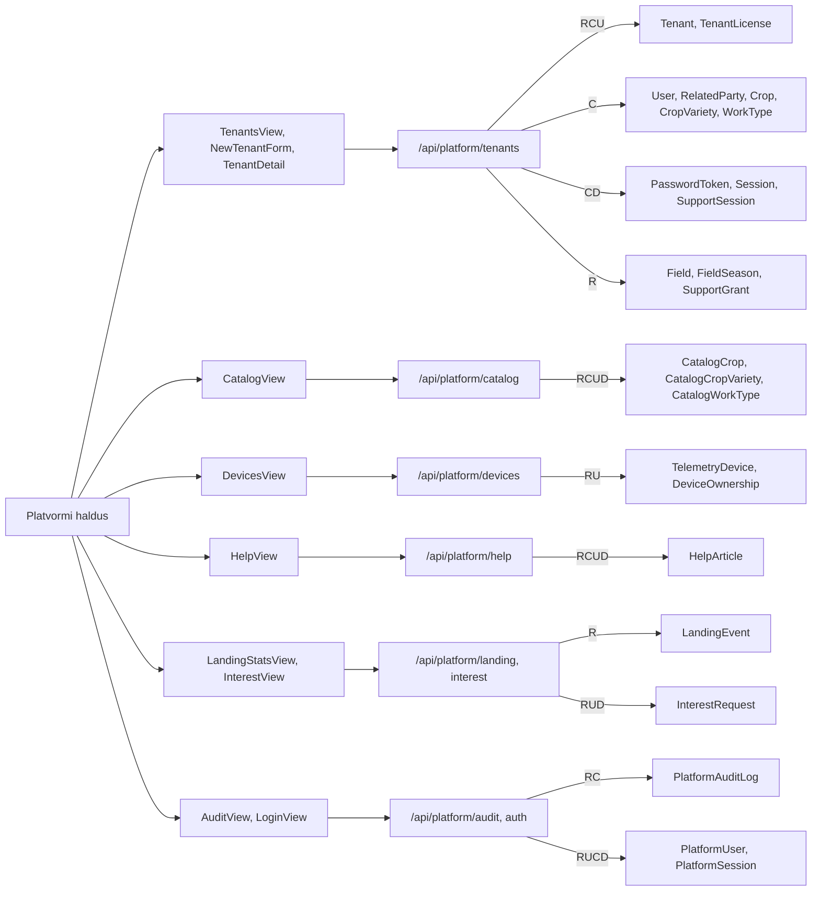

| Komponent | Tegevus (kasutaja vaates) | API | Tabelid (R/C/U/D) |
|---|---|---|---|
| `LoginView` / `AdminApp` | logib sisse (parool + TOTP), välja | `POST /api/platform/auth/login`, `POST /api/platform/auth/logout`, `GET /api/platform/auth/me` | `PlatformUser` RU, `PlatformSession` RCD, `PlatformAuditLog` C |
| `TenantsView` | ettevõtete loend (kasutajad, põllud, pindala, litsents) | `GET /api/platform/tenants` | `Tenant` R, `TenantLicense` R, `User` R, `Field` R, `FieldSeason` R |
| `NewTenantForm` | loob ettevõtte koos litsentsi, peamise isiku, esimese admini ja kataloogi koopiaga; saadab kutse | `POST /api/platform/tenants` | `Tenant` CU, `RelatedParty` C, `TenantLicense` C, `User` C, `CatalogCrop`/`CatalogCropVariety`/`CatalogWorkType` R → `Crop`, `CropVariety`, `WorkType` C, `PasswordToken` CD, `PlatformAuditLog` C |
| `TenantDetail` | ettevõtte detailid ja kasutajad | `GET /api/platform/tenants/:id` | `Tenant` R, `TenantLicense` R, `User` R, `Field` R, `FieldSeason` R, `SupportGrant` R |
| `TenantDetail` / `LicenseCell` | muudab litsentsi | `PATCH /api/platform/tenants/:id/license` | `Tenant` R, `TenantLicense` RCU, `PlatformAuditLog` C |
| `TenantDetail` | peatab või aktiveerib ettevõtte | `POST /api/platform/tenants/:id/suspend`, `.../activate` | `Tenant` RU, `Session` D (peatamisel), `PlatformAuditLog` C |
| `TenantDetail` | avab tugivaate (ettevõtte antud loa alusel) | `POST /api/platform/tenants/:id/support-session` | `SupportGrant` R, `SupportSession` C, `PlatformAuditLog` C |
| `TenantDetail` | saadab kutse uuesti | `POST /api/platform/tenants/:id/resend-invite` | `User` R, `PasswordToken` CD |
| `CatalogView` | kataloogi kultuurid, sordid ja tööliigid (uue ettevõtte algandmed) | `GET /api/platform/catalog`, `POST`/`PATCH`/`DELETE .../catalog/crops`, `.../varieties`, `.../catalog/work-types` | `CatalogCrop` RCUD, `CatalogCropVariety` RCUD, `CatalogWorkType` RCUD, `CatalogWorkTemplateItem` D, `PlatformAuditLog` C |
| `DevicesView` | kõigi ettevõtete seadmed ja registreerimised; vabastab seadme | `GET /api/platform/devices`, `GET .../devices/registrations`, `POST .../devices/:id/release` | `TelemetryDevice` RU, `Tenant` R, `DeviceOwnership` RU, `PlatformAuditLog` C |
| `HelpView` | muudab rakenduse juhendeid (tühi tekst kustutab) | `GET /api/platform/help`, `PUT /api/platform/help/:key` | `HelpArticle` RCUD, `PlatformAuditLog` C |
| `LandingStatsView` | avalehe külastuste statistika | `GET /api/platform/landing/stats` | `LandingEvent` R |
| `InterestView` | huviliste päringud: olek, märkused, kustutamine | `GET /api/platform/interest`, `PATCH`/`DELETE /api/platform/interest/:id` | `InterestRequest` RUD, `PlatformAuditLog` C |
| `AuditView` | auditilogi | `GET /api/platform/audit`, `GET /api/platform/tenants` | `PlatformAuditLog` R, `PlatformUser` R, `Tenant` R |

## Avaleht (landing)

Avalik leht (`landing.html`, `src/landing/landing.ts`) salvestab külastused (`POST /api/landing/event` → `LandingEvent` C, vanad kirjed kustutatakse säilitusaja järgi) ja huviliste vormi (`POST /api/landing/interest` → `InterestRequest` C).

## API → tabelid

Ettevõtte API (`src/server/apiHandler.ts`, `fieldWorks.ts`, `authGate.ts`, `adminUsers.ts`, `supportGrants.ts`, `helpArticles.ts`, `landing/landingApi.ts`). Lisaks loeb iga sisselogitud päring `Session`, `Tenant` ja `TenantLicense` tabelit (vt lugemisjuhend).

| Meetod + tee | Tabelid R | Tabelid C/U/D | Märkus |
|---|---|---|---|
| `GET /api/auth/me` | `Session`, `User`, `Tenant`, `TenantLicense` | U: `Session`, `User` | libisev aegumine |
| `POST /api/auth/login` | `User`, `Tenant` | C: `Session`; U: `User`; D: `Session` (aegunud) | |
| `POST /api/auth/support-login` | `SupportSession`, `SupportGrant`, `Tenant`, `PlatformUser` | U/D: `SupportSession`; C: `SupportAccessLog` | tugivaate üleandmistoken |
| `POST /api/auth/logout` | — | D: `Session`, `SupportSession` | |
| `POST /api/auth/forgot` | `User`, `Tenant` | C/D: `PasswordToken` | saadab e-kirja |
| `POST /api/auth/token` | `PasswordToken`, `User` | — | |
| `POST /api/auth/set-password` | `PasswordToken`, `User` | U: `PasswordToken`, `User`; D: `PasswordToken`, `Session` | |
| `POST /api/auth/password` | `User` | U: `User`; D: `Session`, `PasswordToken` | |
| `GET /api/admin/users` | `User`, `Session` | — | ainult admin |
| `POST /api/admin/users` | `User` | C: `User`, `PasswordToken`; D: `PasswordToken` | kutse e-kiri |
| `PATCH /api/admin/users/:id` | `User` | U: `User`; D: `Session`, `PasswordToken` | |
| `DELETE /api/admin/users/:id` | `User` | D: `User`; kaskaad D: `Session`, `PasswordToken`, `SupportGrant`, `SupportAccessLog`; nullimine U: `FieldWork`, `WorkEntry` | |
| `POST /api/admin/users/:id/password` | `User` | U: `User`; D: `Session`, `PasswordToken` | |
| `POST /api/admin/users/:id/send-link` | `User` | C/D: `PasswordToken` | |
| `GET /api/support-grants` | `SupportGrant` | — | |
| `POST /api/support-grants` | `SupportGrant` | C: `SupportGrant` | üks kehtiv luba korraga |
| `POST /api/support-grants/:id/revoke` | `SupportGrant` | U: `SupportGrant`; D: `SupportSession` | lubatud ka aegunud litsentsiga |
| `GET /api/support-access-log` | `SupportAccessLog` | — | |
| `GET /api/help` | `HelpArticle` | — | |
| `GET /api/status` | `Season`, `Field`, `FieldSeason`, `PointOfInterest`, `Vehicle`, `Crop` (loendid) | — | ühenduse kontroll |
| `GET /api/seasons` | `Season` | — | |
| `POST /api/seasons` | `Season` | C/U: `Season` | sulgemise aeg ja sulgeja serverist |
| `GET /api/master-fields` | `Field`, `FieldSeason`, `FieldCadastralParcel`, `CadastralParcel`, `RelatedParty`, `FieldWork` (loend) | — | |
| `POST /api/master-fields` | `Field` | C/U: `Field`, `FieldSeason`, `CadastralParcel`, `FieldCadastralParcel`; C: `Season`; D: `FieldCadastralParcel` | massiiv = PRIA import (ainult admin); katastri seosed ainult kui kliendilt tulid |
| `DELETE /api/master-fields/:id` | `Field` | D: `Field`; kaskaad D: `FieldSeason`, `FieldCadastralParcel`, `FieldWork`, `FieldWorkLine`, `WorkEntry`, `WorkEntryLine` | looja või admin |
| `GET /api/poi` | `PointOfInterest` | — | |
| `POST /api/poi` | — | C/U: `PointOfInterest` | upsert id järgi |
| `DELETE /api/poi/:id` | `PointOfInterest` | D: `PointOfInterest` | looja või admin |
| `GET /api/fleet` | `Vehicle`, `RelatedParty`, `Implement`, `TelemetryDevice`, `DeviceAssignment`, `ImplementAssignment`, `DeviceOwnership`, tsdb `measurements` | — | `?telemetry=0` ja ilma moodulita tsdb päringuid pole |
| `POST /api/fleet/vehicles` | — | C/U: `Vehicle` | |
| `DELETE /api/fleet/vehicles/:id` | `Vehicle` | U: `ImplementAssignment`; D: `Vehicle`; kaskaad D: `ImplementAssignment`; nullimine U: `DeviceAssignment`, `WorkEntry`, `WorkEntryLine` | looja või admin |
| `POST /api/fleet/implements` | — | C/U: `Implement` | |
| `DELETE /api/fleet/implements/:id` | `Implement` | U: `ImplementAssignment`, `Vehicle`; D: `Implement`; kaskaad D: `ImplementAssignment`; nullimine U: `DeviceAssignment`, `WorkEntry`, `WorkEntryLine` | looja või admin |
| `POST /api/fleet/devices` | `TelemetryDevice` | C/U: `TelemetryDevice`, `DeviceOwnership` | moodul TELEMETRY; 409 kui seade on teisel ettevõttel |
| `DELETE /api/fleet/devices/:id` | `TelemetryDevice` | D: `TelemetryDevice`; U: `DeviceOwnership`; kaskaad D: `DeviceAssignment` | moodul TELEMETRY |
| `POST /api/fleet/implements/assign` | `ImplementAssignment` | C/U: `ImplementAssignment` | |
| `GET /api/fleet/implement-assignments` | `ImplementAssignment`, `Vehicle`, `Implement` | — | |
| `POST /api/fleet/implement-assignments` | `Vehicle`, `Implement` | C: `ImplementAssignment` | |
| `PUT`/`PATCH /api/fleet/implement-assignments/:id` | `Vehicle`, `Implement` | U: `ImplementAssignment` | |
| `DELETE /api/fleet/implement-assignments/:id` | `ImplementAssignment` | D: `ImplementAssignment` | looja või admin |
| `GET /api/fleet/device-assignments` | `DeviceAssignment`, `TelemetryDevice`, `Vehicle`, `Implement` | — | moodul TELEMETRY |
| `POST /api/fleet/device-assignments` | `TelemetryDevice`, `Vehicle`, `Implement` | C: `DeviceAssignment` | moodul TELEMETRY |
| `PUT`/`PATCH /api/fleet/device-assignments/:id` | `TelemetryDevice`, `Vehicle`, `Implement` | U: `DeviceAssignment` | moodul TELEMETRY |
| `DELETE /api/fleet/device-assignments/:id` | `DeviceAssignment` | D: `DeviceAssignment` | looja või admin |
| `POST /api/fleet/devices/assign` | `TelemetryDevice`, `DeviceAssignment`, `DeviceOwnership`, tsdb `measurements` | C/U: `DeviceAssignment`; U: `Vehicle` | moodul TELEMETRY |
| `GET /api/weather/radar`, `GET /api/weather/radar.png` | — | — | väline KAIA; moodul WEATHER |
| `GET /api/satellite/dates` | — | — | väline Satiladu; moodul SATELLITE |
| `POST /api/satellite/cloud-check` | — | — | väline Satiladu; ainult lugev POST |
| `GET /api/telemetry/history` | `DeviceAssignment`, `TelemetryDevice`, `Implement`, `ImplementAssignment`, `DeviceOwnership`, tsdb `measurements` | — | moodul TELEMETRY |
| `GET /api/parties` | `RelatedParty`, `Vehicle`, `FieldCadastralParcel`, `PointOfInterest`, `Field` (loendid) | — | |
| `POST /api/parties` | — | C/U: `RelatedParty` | |
| `DELETE /api/parties/:id` | `RelatedParty` | D: `RelatedParty`; nullimine U: `Field`, `FieldCadastralParcel`, `PointOfInterest`, `Vehicle`, `FieldWork`, `WorkEntry` | looja või admin |
| `GET /api/crops` | `Crop`, `CropVariety` | — | |
| `POST /api/crops` | `Crop` | C/U: `Crop`, `CropVariety`; D: `CropVariety`; U: `FieldSeason` (värv) | |
| `DELETE /api/crops/:id` | `Crop` | D: `Crop`; kaskaad D: `CropVariety`, `WorkTemplate`, `WorkTemplateItem`; nullimine U: `FieldSeason`, `Material` | looja või admin |
| `GET /api/soil-samples` | `SoilSample` | — | |
| `POST /api/soil-samples/import` | — | C/U: `SoilSample`; C: `Season` | ainult admin |
| `POST /api/field-book/import` | `Season`, `Field`, `FieldSeason`, `WorkType`, `Material`, `FieldWork` | C: `Season`, `WorkType`, `Material`, `FieldWork`, `FieldWorkLine`, `WorkEntry`, `WorkEntryLine`; U: `FieldSeason`, `FieldWork` | ainult admin; üks tehing; lukus hooaeg jäetakse vahele |
| `GET /api/work-types` | `WorkType`, `FieldWork` (loend) | — | |
| `POST /api/work-types` | — | C/U: `WorkType` | |
| `DELETE /api/work-types/:id` | `WorkType`, `FieldWork` (loend) | D: `WorkTemplateItem`, `WorkType` | keelatud, kui töö on põldudel kasutusel |
| `GET /api/materials` | `Material`, `WorkEntryLine`; `?year=` korral ka `FieldWorkLine`, `FieldWork`, `FieldSeason` | — | |
| `POST /api/materials` | — | C/U: `Material` | |
| `DELETE /api/materials/:id` | `Material`, `WorkEntryLine` | D: `Material` | keelatud, kui kannetes kasutusel |
| `GET /api/field-season-works` | `FieldSeason`, `FieldWork`, `WorkType`, `FieldWorkLine`, `WorkEntry`, `WorkEntryLine`, `RelatedParty`, `Vehicle`, `Implement` | — | finantsväljad ainult admin/finantsjuht |
| `GET /api/field-works` | `Crop`, `FieldSeason`, `FieldWork`, `WorkType`, `FieldWorkLine`, `WorkEntry`, `WorkEntryLine`, `RelatedParty`, `Vehicle`, `Implement` | U: `FieldSeason` | kõrvalmõju: talivilja pärimine eelmisest aastast |
| `POST /api/field-works` | `WorkType`, `FieldWork` | C: `FieldWork`, `FieldWorkLine` | |
| `POST /api/field-works/clear` | `FieldSeason`, `Season`, `WorkEntry`, `FieldWork` | D: `FieldWork`; kaskaad D: `FieldWorkLine` | lukus hooaeg keelatud |
| `PATCH /api/field-works/:id` | `FieldWork`, `WorkEntry` | U: `FieldWork`; C/D: `FieldWorkLine` | `status` DONE/REOPEN |
| `DELETE /api/field-works/:id` | `FieldWork`, `WorkEntry` | D: `FieldWork`; kaskaad D: `FieldWorkLine` | keelatud, kui kandeid on |
| `GET /api/field-works/telemetry-suggestions` | `FieldWork`, `FieldSeason`, `WorkEntry`, `DeviceAssignment`, `TelemetryDevice`, `Vehicle`, `RelatedParty`, `Implement`, `ImplementAssignment`, `DeviceOwnership`, `Field`, `PointOfInterest`, tsdb `measurements` | — | moodul TELEMETRY |
| `POST /api/work-entries` | `FieldWork`, `RelatedParty`, `Vehicle`, `Implement`, `Material`, `WorkEntry` | C: `WorkEntry`, `WorkEntryLine`; U: `FieldWork` (olek) | |
| `PUT /api/work-entries/:id` | `WorkEntry`, `WorkEntryLine`, `RelatedParty`, `Vehicle`, `Implement`, `Material` | U: `WorkEntry`, `FieldWork`; C/D: `WorkEntryLine` | kinnitatud hinnad säilitatakse, finantsolek võib muutuda |
| `DELETE /api/work-entries/:id` | `WorkEntry` | D: `WorkEntry`; kaskaad D: `WorkEntryLine`; U: `FieldWork` | kinnitatud kanne ainult finantsjuht |
| `GET /api/finance/entries` | `FieldSeason`, `WorkEntry`, `WorkEntryLine`, `FieldWork`, `WorkType`, `Field`, `RelatedParty`, `Vehicle`, `Implement` | — | admin/finantsjuht |
| `PATCH /api/finance/entries/:id` | `WorkEntry`, `WorkEntryLine` | U: `WorkEntry`, `WorkEntryLine` | hinnad, kinnitamine |
| `GET /api/finance/field-results` | `Crop`, `FieldSeason`, `Field`, `FieldWork`, `WorkEntry`, `WorkEntryLine` | — | admin/finantsjuht |
| `POST /api/landing/event` | — | C: `LandingEvent`; D: `LandingEvent`, `InterestRequest` (säilitusaeg) | avalik |
| `POST /api/landing/interest` | — | C: `InterestRequest` | avalik |

Platvormi API (`src/server/platformApi.ts`, `platformAuth.ts`; ainult platvormi hostil):

| Meetod + tee | Tabelid R | Tabelid C/U/D | Märkus |
|---|---|---|---|
| `POST /api/platform/auth/login` | `PlatformUser` | U: `PlatformUser`; C: `PlatformSession`, `PlatformAuditLog`; D: `PlatformSession` (aegunud) | parool + TOTP |
| `POST /api/platform/auth/logout` | — | D: `PlatformSession` | |
| `GET /api/platform/auth/me` | `PlatformSession`, `PlatformUser` | — | |
| `GET /api/platform/tenants` | `Tenant`, `TenantLicense`, `User`, `Field`, `FieldSeason` | — | koondandmed |
| `POST /api/platform/tenants` | `CatalogCrop`, `CatalogCropVariety`, `CatalogWorkType` | C: `Tenant`, `RelatedParty`, `TenantLicense`, `User`, `Crop`, `CropVariety`, `WorkType`, `PasswordToken`, `PlatformAuditLog`; U: `Tenant`; D: `PasswordToken` | kataloogi koopia, kutse |
| `GET /api/platform/tenants/:id` | `Tenant`, `TenantLicense`, `User`, `Field`, `FieldSeason`, `SupportGrant` | — | |
| `PATCH /api/platform/tenants/:id/license` | `Tenant`, `TenantLicense` | C/U: `TenantLicense`; C: `PlatformAuditLog` | |
| `POST /api/platform/tenants/:id/suspend`, `.../activate` | `Tenant` | U: `Tenant`; D: `Session` (peatamisel); C: `PlatformAuditLog` | |
| `POST /api/platform/tenants/:id/support-session` | `SupportGrant` | C: `SupportSession`, `PlatformAuditLog` | |
| `POST /api/platform/tenants/:id/resend-invite` | `User` | C/D: `PasswordToken` | |
| `GET /api/platform/audit` | `PlatformAuditLog`, `PlatformUser` | — | |
| `GET /api/platform/devices` | `TelemetryDevice`, `Tenant`, `DeviceOwnership` | — | |
| `GET /api/platform/devices/registrations` | `DeviceOwnership`, `Tenant` | — | |
| `POST /api/platform/devices/:id/release` | `TelemetryDevice` | U: `TelemetryDevice`, `DeviceOwnership`; C: `PlatformAuditLog` | |
| `GET /api/platform/catalog` | `CatalogCrop`, `CatalogCropVariety`, `CatalogWorkType` | — | |
| `POST`/`PATCH`/`DELETE /api/platform/catalog/crops[/:id]` | `CatalogCrop` | C/U/D: `CatalogCrop`; kaskaad D: `CatalogCropVariety`; C: `PlatformAuditLog` | |
| `POST`/`PATCH`/`DELETE /api/platform/catalog/crops/:id/varieties[/:id]` | `CatalogCrop`, `CatalogCropVariety` | C/U/D: `CatalogCropVariety`; C: `PlatformAuditLog` | |
| `POST`/`PATCH`/`DELETE /api/platform/catalog/work-types[/:id]` | `CatalogWorkType` | C/U/D: `CatalogWorkType`; D: `CatalogWorkTemplateItem`; C: `PlatformAuditLog` | |
| `GET /api/platform/help` | `HelpArticle` | — | |
| `PUT /api/platform/help/:key` | `HelpArticle` | C/U/D: `HelpArticle`; C: `PlatformAuditLog` | tühi tekst kustutab |
| `GET /api/platform/landing/stats` | `LandingEvent` | — | |
| `GET /api/platform/interest` | `InterestRequest` | — | |
| `PATCH /api/platform/interest/:id` | `InterestRequest` | U: `InterestRequest`; C: `PlatformAuditLog` | |
| `DELETE /api/platform/interest/:id` | — | D: `InterestRequest`; C: `PlatformAuditLog` | |

## CRUD-maatriks

Veerud: **Kaart**, **Põld** (põllu aken koos dialoogidega), **Hooaj** (Hooajad), **Põllud** (koos impordiakendega), **Kult** (Kultuurid), **Külv** (Külvikord), **Tööd** (Põllutööd koos finantside ja tööliikide registriga), **Mat** (Kulumaterjalid), **Tehn** (Tehnika), **Tar** (Taristu), **Isik** (Isikud), **Konto** (sisselogimine, kasutajad, tugi), **Platv** (platvormi haldus). Käivituse andmetest kuvatav loetakse vaate lugemiseks (`R`). Kaskaadi ja nullimise mõjud on arvestatud (`D` ja `U`). Iga sisselogitud päringu `Session`/`Tenant`/`TenantLicense` lugemine on maatriksist välja jäetud.

| Tabel | Kaart | Põld | Hooaj | Põllud | Kult | Külv | Tööd | Mat | Tehn | Tar | Isik | Konto | Platv |
|---|---|---|---|---|---|---|---|---|---|---|---|---|---|
| `Season` | R | RC | RCU | RC | | RC | R | R | | | | | |
| `Field` | R | RU | R | RCUD | R | RU | R | | | | RU | | R |
| `FieldSeason` | R | RCU | R | RCUD | RU | RCU | RU | R | | | | | R |
| `CadastralParcel` | | CU | | CU | | CU | | | | | | | |
| `FieldCadastralParcel` | | RCUD | | RCUD | | CUD | | | | | RU | | |
| `Crop` | | R | | R | RCUD | R | R | | | | | | C |
| `CropVariety` | | | | | RCUD | | | | | | | | C |
| `SoilSample` | R | R | | CU | | | | | | | | | |
| `RelatedParty` | R | R | | R | | | R | | R | | RCUD | | C |
| `PointOfInterest` | R | R | | | | | R | | | RCUD | RU | | |
| `Vehicle` | R | R | | | | | R | | RCUD | | RU | | |
| `Implement` | R | R | | | | | R | | RCUD | | | | |
| `TelemetryDevice` | R | R | | | | | R | | RCUD | | | | RU |
| `DeviceOwnership` | R | R | | | | | R | | RCU | | | | RU |
| `DeviceAssignment` | R | R | | | | | R | | RCUD | | | | |
| `ImplementAssignment` | R | R | | | | | R | | RCUD | | | | |
| `WorkType` | | R | | RC | | | RCUD | | | | | | C |
| `Material` | | R | | RC | U | | RCUD | RCUD | | | | | |
| `WorkTemplate` | | | | | D | | | | | | | | |
| `WorkTemplateItem` | | | | | D | | D | | | | | | |
| `FieldWork` | | RCU | | RCUD | | R | RCUD | R | | | U | U | |
| `FieldWorkLine` | | RCD | | CD | | | RCD | R | | | | | |
| `WorkEntry` | | RCU | | CD | | | RCUD | | U | | U | U | |
| `WorkEntryLine` | | RCD | | CD | | | RCUD | R | U | | | | |
| `User` | | | | | | | | | | | | RCUD | RC |
| `Session` | | | | | | | | | | | | RCUD | D |
| `PasswordToken` | | | | | | | | | | | | RCUD | CD |
| `SupportGrant` | | | | | | | | | | | | RCUD | R |
| `SupportAccessLog` | | | | | | | | | | | | RCD | |
| `SupportSession` | | | | | | | | | | | | RUD | C |
| `HelpArticle` | | | | R | | R | | | | | | | RCUD |
| `Tenant` | | | | | | | | | | | | R | RCU |
| `TenantLicense` | | | | | | | | | | | | R | RCU |
| `PlatformUser` | | | | | | | | | | | | R | RU |
| `PlatformSession` | | | | | | | | | | | | | RCD |
| `PlatformAuditLog` | | | | | | | | | | | | | RC |
| `CatalogCrop` | | | | | | | | | | | | | RCUD |
| `CatalogCropVariety` | | | | | | | | | | | | | RCUD |
| `CatalogWorkType` | | | | | | | | | | | | | RCUD |
| `CatalogWorkTemplate` | | | | | | | | | | | | | |
| `CatalogWorkTemplateItem` | | | | | | | | | | | | | D |
| `LandingEvent` | | | | | | | | | | | | | R |
| `InterestRequest` | | | | | | | | | | | | | RUD |
| tsdb `measurements` | R | R | | | | | R | | R | | | | |

Märkused maatriksi juurde:
- `HelpArticle` R tähendab juhendimullikesi (`HelpHint`), mis laaditakse üks kord rakenduse kohta (`GET /api/help`); praegu on `HelpHint` ainult komponentides `FieldsTableView` ja `FieldManagerModal`.
- Avaleht lisab `LandingEvent` ja `InterestRequest` kirjeid (C), vt [Avaleht](#avaleht-landing).
- `CatalogWorkTemplate` ei kasuta ükski API tee; `WorkTemplate`/`WorkTemplateItem` ridu kustutatakse ainult kaskaadi või tööliigi kustutamise kaudu (mallid on eemaldatud funktsioon).

## Rakenduse käivitusel laetavad andmed

`App.tsx` laeb pärast `GET /api/status` vastust („connected“) paralleelselt järgmised andmed ja hoiab neid App-taseme olekus. Vaated saavad need omaduste (props) kaudu; salvestamise järel uuendatakse olekut kohe ja päring saadetakse taustal (kustutamisel alles pärast serveri kinnitust).

| Andmed (olek) | API | Tabelid | Kasutavad vaated |
|---|---|---|---|
| `masterFields` | `GET /api/master-fields` | `Field`, `FieldSeason`, `FieldCadastralParcel`, `CadastralParcel`, `RelatedParty` (operaator), `FieldWork` (loend) | Kaart (põllukiht, valitud hooaja kaupa), Põllu aken, Hooajad (statistika), Põllud, Kultuurid (pindalad), Külvikord, Põllutööd (read), Isikud (seosed), `FieldBookUploadModal`, `FieldEditDialog` |
| `seasons` | `GET /api/seasons` | `Season` | hooaja valik kõikjal (`MapYearSelector`, aastavalikud), Hooajad, Põllud, Külvikord, Kultuurid, Põllutööd, Kulumaterjalid, Põllu aken, `FieldEditDialog`, `FieldBookUploadModal`; aktiivne hooaeg määrab vaikimisi aasta |
| `rawVehicles`, `implementsList`, `devices` | `GET /api/fleet?telemetry=0` (ilma reaalajas asukohtadeta) | `Vehicle`, `RelatedParty`, `Implement`, `TelemetryDevice`, `DeviceAssignment`, `ImplementAssignment` | Tehnika, Kaart (masinate kiht, rajad), Põllutööd ja kandedialoog (masinate/haakeriistade valik), Isikud (masinad) |
| `pois` | `GET /api/poi` | `PointOfInterest` | Kaart (objektide kiht), Taristu |
| `parties` | `GET /api/parties` | `RelatedParty` (+ viidete loendid) | päise operaatori filter (`OperatorSelector`), Põllud, `FieldEditDialog`, Põllutööd ja dialoogid (töötajad = roll DRIVER), `FieldUploadModal`, `FieldBookUploadModal`, Isikud |
| `crops` | `GET /api/crops` | `Crop`, `CropVariety` | Kultuurid, Põllud, Külvikord, Põllutööd, `FieldEditDialog`; PRIA impordil kultuuri värvi määramine |
| `soilSamples` | `GET /api/soil-samples` | `SoilSample` | Kaart (mullaproovide kiht), Põllu aken (mullaproovide jaotis) |

Hiljem (vajadusel) laetavad:
- `GET /api/fleet` (koos telemeetriaga) — kui kaardil lülitatakse sisse masinate kiht või avatakse Tehnika vaade (üks kord seansis; uuesti kihi sisselülitamisel ja pärast seoste registri muutmist).
- `GET /api/telemetry/history` — kaardi kiht „Põllutööd“ ja harimise taasesitus.
- `GET /api/work-types` + `GET /api/materials` — esimese plaani- või kandedialoogi avamisel põllu aknast (`ensureWorkRefs`); Põllutööde ja Kulumaterjalide vaade laevad need ise.
- `GET /api/help` — esimese juhendimullikese (`HelpHint`) kuvamisel.
- `GET /api/auth/me` — `AuthGate` enne rakenduse avamist (kasutaja, rollid, ettevõtte nimi, litsents).

## Tähelepanekud ja ebakindlused

Koodi läbivaatusel leitud ja 26.10.2026 parandatud:
- **Ühe põllu salvestamine** saadab nüüd ainult põllu üldandmed ja muudetud aasta kirje; lukus hooaja kirjet ei muudeta (403); salvestus on ühes tehingus ja pärast seda laetakse põllud serverist uuesti.
- **Uus hooaeg kõigile põldudele** luuakse serveris (`POST /api/seasons/:year/fields`): kirjed kopeeritakse viimasest aastast koos katastriseostega, olemasolevaid ei muudeta.
- **PRIA impordi valik „Asenda olemasolevad põllud“** eemaldab serveris (`POST /api/master-fields/replace-year`) failist puuduvate põldude selle aasta kirjed sama operaatori piires; töödega kirjed jäetakse alles.
- **`GET /api/field-works` ainult loeb**; eelmise aasta talivilja kultuuri enam ei pärita.
- **Põllu kustutamine:** kandega põldu ei kustutata (409, teade hooaegade kaupa); kanneteta põllu kustutamisel küsitakse alati kinnitust koos planeeritud tööde arvuga (`GET /api/master-fields/:id/delete-check`).
- **Materjali kustutamine** kontrollib nüüd ka tööde plaanide ridu (`FieldWorkLine`) ja annab arusaadava teate.

Endiselt kehtivad:
- **Masina/haakeriista kustutamisel** lõpetatakse avatud haakimised (U), kuid kohe järel kustutab kaskaad need kirjed niikuinii (`ImplementAssignment` `onDelete: Cascade`).
- **Kasutamata App-taseme aknad (kontrollimata):** `SeasonManagerModal`, `FieldManagerModal` ja `PoiManagerModal` on `App.tsx`-is ka modaalina (`isSeasonManagerOpen`, `isFieldsRegisterOpen`, `isPoiModalOpen`); võimalik, et neid ei ava ükski nupp ja kasutusel on ainult täislehe variandid.

Ebakindlused:
- Tabelite loetelu „R“ veerus põhineb Prisma `include`/`select` päringutel; lugemine sisemiste abifunktsioonide kaudu (nt `syncFieldWorkStatus`, `materialSeasonTotals`, `buildEntryLines`) on kontrollitud nende failide päringute järgi, kuid kõiki haru-tingimusi (millal mingi päring jääb tegemata) pole eraldi märgitud.
- Tsdb päringud (`telemetryAccess.ts`) loevad tabelit `measurements` (`packets` ja `numbered` on päringusisesed CTE-d); tsdb skeemi ennast pole selle dokumendi jaoks üle vaadatud.
